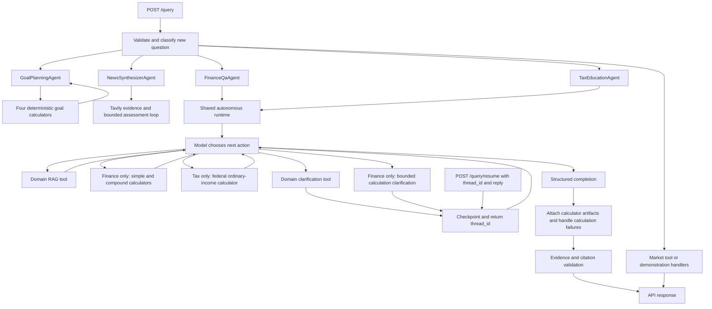
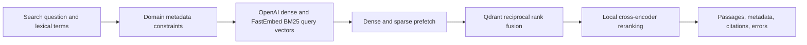
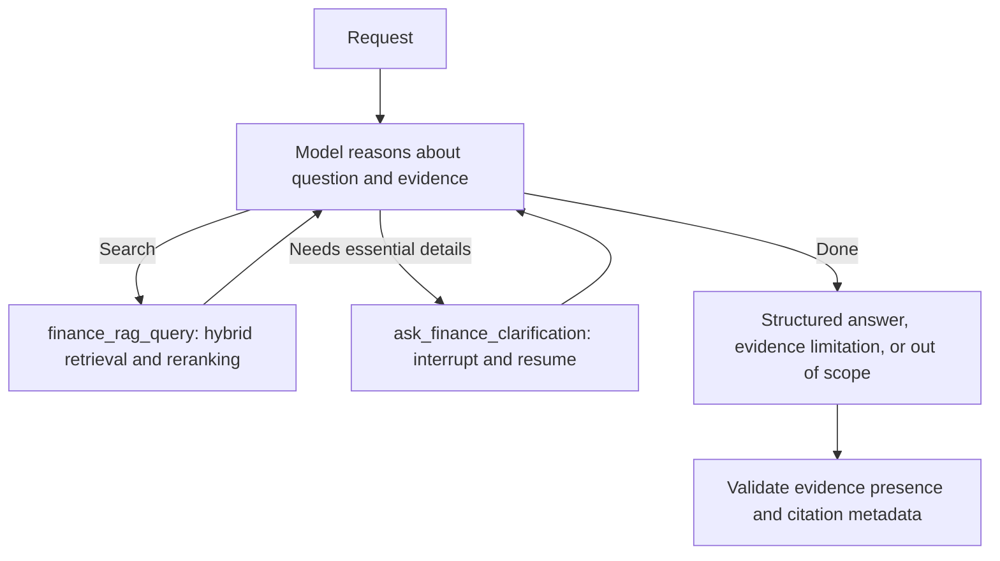
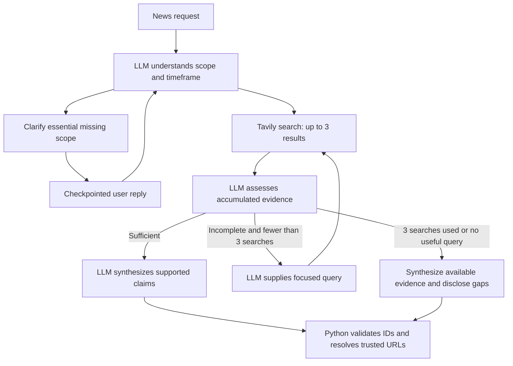

# AI Finance Assistant

**An education API with autonomous finance and tax agents, complete hybrid RAG tools, and checkpointed clarification.**


Ask an investing, US tax, savings-goal, or financial-news question in plain English. Separate tool-calling agents choose searches, assess retrieved evidence, request essential clarification, and return cited answers or evidence limitations. A shared runtime handles execution limits and API integration; domain RAG tools handle embeddings, Qdrant fusion, reranking, and citation packaging in one invocation.

[Quick start](#quick-start) · [API](#api) · [Architecture](#architecture) · [Finance QA](#finance-qa-agentic-rag) · [Tax](#tax-education) · [Goal planning](#goal-planning-agent) · [News](#news-synthesizer-agent) · [Example queries](#example-queries) · [Configuration](#configuration) · [Storage and operations](#index-lifecycle-and-operations) · [Development](#development)

## Capabilities

| Capability | Example | Implementation |
| --- | --- | --- |
| Investment education | “Explain NAV versus market price for an ETF.” | Autonomous Finance QA agent with a hybrid retrieval and reranking tool. |
| Concept comparisons | “What is the difference between buying QQQ and tracking the Nasdaq-100?” | Up to three dense subqueries and a shared lexical search; evaluates combined evidence coverage. |
| Options education | “How do Delta and Theta affect a call option?” | Handbook-grounded explanations; the model chooses follow-up searches within its budget. |
| Finance clarification | “Which is better?” | Interrupts retrieval for essential missing details; supports a checkpointed reply through `/query/resume`. |
| US tax education | “Explain capital gains for tax year 2026.” | Autonomous tax agent with original-question metadata constraints and a hybrid RAG tool. |
| Market quotes | “What is Apple's latest available stock price?” | Twelve Data MCP quotes with price, volume, and daily changes. |
| Goal planning | “Can I reach $100,000 in five years saving $1,000 monthly?” | Tool-calling Goal Planning Agent with deterministic projections, clarification, and a three-iteration limit. |
| News synthesis | “Give me the latest financial-market news.” | Tavily evidence, LLM coverage assessment, up to three searches, and verified citation provenance. |
| Portfolio | Holdings analysis | Fixed demonstration response; holdings analysis is not implemented. |

The project is in active development. Finance, tax, market, and goal-planning agents are implemented, but the complete application is not production-ready. The operational limitations below describe the current code, including differences from the [Finance Agentic RAG coding prompt](resources/prompts/Finance_Agentic_RAG_Coding_Agent_Prompt.md).

## Documentation guide

| Goal | Reference |
| --- | --- |
| Run locally and send a first request | [Quick start](#quick-start) |
| Integrate a client or resume clarification | [API](#api) |
| Understand routing and evidence retrieval | [Architecture](#architecture) · [Finance QA](#finance-qa-agentic-rag) |
| Set models, providers, and retrieval limits | [Configuration](#configuration) |
| Understand embedding reuse and collection migration | [Index lifecycle and operations](#index-lifecycle-and-operations) |
| Locate implementation and run checks | [Repository guide](#repository-guide) · [Development](#development) |
| Assess deployment readiness | [Current limitations and next steps](#current-limitations-and-next-steps) |

## Quick start

### Requirements

- Python **3.12** (`>=3.12,<3.13`).
- An OpenAI API key for routing, query/document embeddings, agent reasoning, and structured answers.
- A Twelve Data API key and the local official Twelve Data MCP server for market quotes.
- The bundled finance PDF and tax JSONL sources in this checkout.
- Network access for provider calls and initial FastEmbed/cross-encoder model downloads.

### Install

```bash
git clone https://github.com/vinodkandibilla/ai-finance-assistant.git
cd ai-finance-assistant
python3.12 -m venv .venv
source .venv/bin/activate
python -m pip install --upgrade pip
python -m pip install -e '.[dev]'
```

Create `.env` in the repository root:

```dotenv
APP_ENV=local
LOG_LEVEL=INFO
OPENAI_API_KEY=your-openai-api-key
OPENAI_MODEL=gpt-4o-mini
OPENAI_EMBEDDING_MODEL=text-embedding-3-small
TWELVE_DATA_API_KEY=your-twelve-data-api-key
QDRANT_MODE=local
FINANCE_COLLECTION=finance_education_hybrid
FINANCE_QUERY_ANALYSIS_MODEL=gpt-4o-mini
FINANCE_CHECKPOINT_PATH=.cache/finance_agent_checkpoints.sqlite
```

Use the default router prompt in `core/config.py`; `.env.example` leaves it unset. If an existing `.env` contains an older `INTENT_ROUTER_SYSTEM_PROMPT`, remove or update that override so classification follows the current domain policies.

### Run

```bash
.venv/bin/python -m uvicorn ai_finance_assistant.main:app --reload
```

Open [Swagger UI](http://127.0.0.1:8000/docs) or [service health](http://127.0.0.1:8000/health).

Server startup opens the SQLite checkpoint connection through FastAPI’s async lifespan and closes it on shutdown. The first query constructs the cached parent graph and initializes both retrieval domains. New collections require embedding calls; Finance QA stores dense and FastEmbed BM25 sparse vectors together in Qdrant. The cross-encoder loads when reranking is first needed. Health checks do not initialize these dependencies or verify provider availability.

## API

| Endpoint | Purpose |
| --- | --- |
| `GET /health` | Returns service status and version. |
| `POST /query` | Classifies and processes a new question. |
| `POST /query/resume` | Supplies a reply to a checkpointed finance, tax, market, or goal clarification. |
| `GET /docs` | Interactive request and response documentation. |

### Ask a question

```bash
curl -X POST http://127.0.0.1:8000/query \
  -H 'Content-Type: application/json' \
  -d '{"query":"Explain NAV versus market price for an ETF."}'
```

Illustrative response shape; answer wording and selected pages vary with retrieval:

```json
{
  "intent": "finance_qa",
  "answer": "An explanation grounded in the retrieved handbook passages, with page citations.",
  "citations": ["Financial Education Handbook, page 12"]
}
```

`intent` and `answer` are always present. New routed requests also include `classified_intent` and `executed_handler`; older checkpoints may omit these fields. Optional fields are omitted when absent:

| Field | Meaning |
| --- | --- |
| `classified_intent` | Original validated LLM classification, preserved even when routing rules choose another handler. |
| `executed_handler` | Parent graph node selected to handle the request, such as `tax_education_node` or `clarify_node`; retained through pause/resume. |
| `status` | Exposes `clarification`, `out_of_scope`, `insufficient`, or `error` when applicable. Successful `answered` status is omitted by the API. |
| `citations` | Finance handbook title/page references or tax corpus record titles; duplicates are combined and internal IDs are omitted. These describe selected context; they are not a verified mapping from claims to sources. |
| `calculations` | Structured results for a request asking for both simple and compound amounts. |
| `calculation` | Optional deterministic calculator result or checkpointed input-collection state; included during calculation clarification and completion. |
| `thread_id` | Checkpoint identifier returned when a clarification is pending. |
| `clarification_question` | The information needed before retrieval can proceed. |

### Resume a clarification

A finance or tax clarification tool can interrupt execution. A finance example:

```json
{
  "intent": "finance_qa",
  "answer": "",
  "status": "clarification",
  "thread_id": "<returned-thread-id>",
  "clarification_question": "Which investment products would you like to compare?"
}
```

```bash
curl -X POST http://127.0.0.1:8000/query/resume \
  -H 'Content-Type: application/json' \
  -d '{"thread_id":"<returned-thread-id>","reply":"ETFs and mutual funds."}'
```

The finance agent receives the reply as a clarification-tool result and chooses its next action. If a reply changes to a task outside the paused agent's scope, that agent returns `out_of_scope` and asks the user to submit a new question. It does not select or invoke another agent. Generic top-level clarification responses do not create this resumable workflow.

### Result handling

Use `classified_intent` for the original router decision and `executed_handler` for the node that handles the request. `intent` remains a compatibility field with its existing behavior: agents can set their own domain on completion, while other handlers may retain the classification. Do not use `intent` alone to infer which node executed. For finance and tax, branch on `status` when present:

| Status | Client behavior |
| --- | --- |
| Omitted on success | Display the answer and optional citations. |
| `clarification` | Display `clarification_question`; retain `thread_id` for `/query/resume`. |
| `out_of_scope` | Submit the changed task as a new question through `/query`; the initial router will choose its handler. |
| `insufficient` | Display the evidence limitation. The shared runtime clears citations for non-answered results. |
| `error` | Display the controlled failure message; detailed internal errors are not exposed in the response. |

Finance citations contain **handbook title and page**; tax citations contain **record titles**. The runtime restricts the citation list to evidence returned by the RAG tool. If the model supplies no valid citations, the runtime uses the available evidence citations, so the list can contain more sources than the answer explicitly cites. Claim-level citation validation and extraction of only answer-used pages are not implemented.

`insufficient` means the question belongs to the agent's domain but evidence cannot support an answer (for example, a requested tax year absent from the corpus). `out_of_scope` means the task is outside the agent's responsibility, regardless of available evidence (for example, a live-stock-price request during a tax clarification). The model should recognize scope mismatches before search when possible; scope decisions are model-directed, not a guaranteed pre-retrieval check.

Example response after changing the task during tax clarification:

```json
{
  "intent": "tax",
  "status": "out_of_scope",
  "answer": "This request is outside my tax-education scope. Please submit it as a new question."
}
```

Out-of-scope completions have no citations or pending thread ID. The checkpoint remains stored, but the task has completed; there is no automatic continuation in another domain. This replaces the previous `handoff` status and removes `handoff_intents` from the response contract.

For example, if the classifier returns `market` for "What is the stock price?", the generic-query rule can select clarification while preserving the original decision:

```json
{
  "intent": "market",
  "classified_intent": "market",
  "executed_handler": "clarify_node",
  "answer": "I need a few more details to answer accurately..."
}
```

The router records the selected handler before entering it, so this metadata is available even when the handler pauses for clarification or returns a controlled error. No second classifier call runs on resume.

### Validation and failures

Router failures are distinguished before any domain handler runs:

| Failure | HTTP status | Response |
| --- | --- | --- |
| Classification deadline or provider timeout | `504` | `Intent classification timed out. Please try again.` |
| Provider connection, rate-limit, authentication, or other OpenAI API error | `503` | `Intent classification provider is unavailable. Please try again later.` |
| Invalid intent schema or structured-output parser failure | `502` | `Intent classification returned an invalid response. Please try again.` |

Responses use the FastAPI `detail` field; logs emit `router_classification_failed` with `category`, `elapsed_ms`, and `timeout_ms`. The same values are available as log-record fields (`failure_category`, `elapsed_ms`, `timeout_ms`). Failure logs omit queries, prompts, credentials, provider bodies, and exception tracebacks; public routing exceptions suppress raw exception chaining. These are routing errors, not `insufficient` evidence results.

New query inputs and resume replies are trimmed and constrained to 1–4,000 characters. Invalid input returns HTTP `422`; an absent OpenAI key produces HTTP `503` during graph construction. Other initialization and unhandled execution failures can become server errors. Unknown or expired thread IDs do not have a dedicated HTTP error contract yet.

## Architecture

The parent LangGraph routes eight intents: `finance_qa`, `tax`, `market`, `portfolio`, `goals`, `news`, `clarify`, and `other`. Validated LLM classification selects the initial domain. There is no keyword-based tax override: incidental mentions of tax, retirement, or deductions do not force tax routing. Identifiable finance/tax questions route to their domain agents even when income, filing status, or comparands are missing; those agents own checkpointed clarification. Generic clarification is reserved for an unidentifiable domain and unsupported/incomplete market requests. Generic market/news rules can still select the clarification handler. Finance and tax then reason autonomously within their domain.



Both agents inherit [`AutonomousEducationAgent`](src/ai_finance_assistant/agents/common/runtime.py). The shared runtime calls `langgraph.prebuilt.create_react_agent`, registers a domain RAG tool and a clarification tool (Finance QA additionally registers direct simple/compound calculators and a bounded calculation-clarification tool; Tax registers a direct federal ordinary-income tax calculator), and adapts message-based agent state to the API's query/result fields. Its one-node adapter does not prescribe analysis, search, evaluation, or retry steps.

The project pins LangChain `>=0.3,<0.4`. `create_react_agent` is compatible with that dependency family but emits deprecation warnings in installed LangGraph versions. Migration to LangChain 1.x `create_agent` has been deferred; no dependency upgrade is required for this implementation.

| Responsibility | Owner |
| --- | --- |
| Choose semantic queries, keywords, tool timing, and follow-up searches | Domain agent model |
| Assess evidence coverage; answer, clarify, or report out of scope | Domain agent model |
| Metadata filtering, embeddings, hybrid search, RRF, reranking, citation packaging | Domain RAG tool |
| Normalize user inputs, choose calculators, clarify ambiguities, compose comparisons | Domain agent model |
| Validate arguments, apply documented defaults, perform Decimal arithmetic | Calculator tools and pure calculation modules |
| Attach structured calculation results and reject failed calculation completions | Domain result adapters |
| Enforce the shared three-message interest-calculation clarification limit | Finance calculation clarification tool and checkpointed history |
| Search budget, recursion limit, interrupt handling, response validation | Shared runtime |
| Prompts, citation format, tax year/status policies | Domain modules |
| Initial domain delegation for new questions | Parent graph |
| Durable clarification checkpoints and API contracts | FastAPI lifespan and async SQLite saver |

Both agents default to a **60-second active execution deadline**, configured separately with `FINANCE_AGENT_TIMEOUT_SECONDS` and `TAX_AGENT_TIMEOUT_SECONDS` (finite positive seconds). One budget covers the tool-calling loop and final structured formatter. Clarification interrupts immediately release the budget; resumed requests start a fresh budget, excluding time spent waiting for the user. Timeout returns the existing domain `status="error"` API contract with a safe timeout answer (HTTP 200, unlike router HTTP 504) and logs `agent_execution_failed` at WARNING with agent name, category, elapsed time and deadline, without queries or provider details. No partial calculator payload is returned on timeout. This is cooperative asyncio cancellation: blocking synchronous work cannot be forcibly preempted, and graph construction/checkpoint persistence are outside the active execution budget.

The parent embeds both domain graphs and compiles with `AsyncSqliteSaver`. Each new request gets a UUID thread ID; the API exposes it when clarification is pending. Resume continues the paused tool call rather than classifying the reply as a new request. The runtime presents the latest actual user reply explicitly in the model context and includes it in the final structured outcome formatting. Clarification artifacts mark `user_reply` versus `policy_guidance`; only actual user replies extend tax constraints.

The diagram shows capabilities available across the two agents, not a fixed action sequence. Each agent receives only its domain tools. Calculators are tools inside the agent loop, not separate parent-graph nodes. There are no calculator preparation tools or nested input-extraction LLM calls. The model supplies calculator arguments directly and writes successful answers using returned amounts; Python retains validation, arithmetic, and API artifact mapping. The three-message calculation clarification cap applies to finance interest requests; tax uses its existing domain clarification tool and runtime recursion limit.

Domain agents know their own scope without knowing which other agents exist. There is no automatic cross-agent transfer, persistent user financial profile, or mixed-intent execution plan. A resumed domain change ends with `out_of_scope`; only a new `/query` request runs initial routing.

### Complete RAG tool pipeline



`finance_rag_query` and `tax_rag_query` include the whole pipeline when invoked standalone or through an agent. Embedding, fusion, and reranking are implementation steps inside the tool, not separately exposed model actions. The agent receives the ranked evidence after one tool invocation and decides whether another search is useful.

Tool factories require a reranker dependency and accept `rerank_top_n` (default 5). Shared [`rag_tools.py`](src/ai_finance_assistant/agents/common/rag_tools.py) packages the results through [`EvidenceResult`](src/ai_finance_assistant/agents/common/schemas.py): `candidates`, `metadata_filters`, `citations`, and `errors`. Candidate records retain content, source metadata, and retrieval identifiers/scores when supplied. A reranking failure returns an error and no unranked evidence; empty retrieval skips reranking. Omitted lexical keywords default to the search question; an explicit empty keyword list disables that sparse query.

Search limits count requested domain search calls, including failed calls. Recursion limits bound the agent loop; a separate configurable execution deadline covers active model/tool calls and final formatting, but does not bound exact provider token cost. Answers marked `answered` without retrieved evidence are rejected. Citation-list validation verifies retrieved source identifiers; it does not independently verify answer claims or inline citations.

## Finance QA agentic RAG

### Scope and knowledge source

Finance QA covers general investment education: stocks, bonds, ETFs, mutual funds, index funds, benchmarks, market terminology, options mechanics and Greeks, diversification, volatility, allocation, and other investing risk concepts.

Retirement accounts, tax and immigration topics, live prices, breaking news, personalized portfolio/planning requests, trades, and account actions are excluded from its education prompt. The agent reports `out_of_scope` for these requests and asks the user to submit a new question. It does not know other agent names or select a destination.

The authoritative finance source is the bundled [Financial Education Handbook PDF](src/ai_finance_assistant/rag/finance-qa/Financial_Education_Handbook_integrated.pdf). The companion DOCX is not loaded. Finance QA does not retrieve from the tax corpus or the web.

Ingestion extracts every nonempty handbook page and chunks it with an **800-character target and 120-character overlap**. No keyword-based domain exclusions run during ingestion; query routing handles domain scope. This preserves mixed-topic pages and incidental tax or retirement mentions. Existing collections must be rebuilt to include previously excluded content.

Each chunk retains source path, document title, 1-based page number, inferred chapter/section, chunk ID, and a SHA-256 document ID. The ID includes the source path and content, so moving the checkout can change IDs.

### Autonomous agent

Finance QA is created with `langgraph.prebuilt.create_react_agent`, the tool-calling agent constructor compatible with this project's LangChain 0.3 dependency. The model chooses its actions rather than following prescribed analysis, evaluation, and retry nodes.



The search tool accepts a question, up to three semantic queries, and lexical keywords. It applies corpus-supported metadata filters, performs Qdrant dense/BM25 retrieval with RRF fusion, and reranks candidates. It returns passages, citation metadata, and errors to the model. The model assesses coverage and may choose focused follow-up searches; there is no separate evaluator or fixed retry node in the active finance agent.

The clarification tool pauses the checkpointed graph and resumes with the user's reply. The model continues the task or reports `out_of_scope` if the user changes domains; the parent graph does not reroute the resumed request. A thin one-node adapter maps the API's query/result fields to the agent's message state.

Searches are capped by `FINANCE_AGENT_MAX_SEARCHES` (default 4); execution is bounded by `FINANCE_AGENT_RECURSION_LIMIT` (default 30). These limits constrain cost without prescribing a search plan. Answers without retrieved evidence are rejected, and the public citation list is restricted to retrieved pages. This does not independently verify every answer claim or inline citation. Retrieval and reranker errors are returned to the model; exhausted execution or provider failures produce controlled errors.

### Compound-interest calculator

Finance QA supports an educational explanation plus a deterministic compound-interest amount in one request:

```json
{"query":"What is compound interest, and how much interest will $10,000 earn over 5 years at 6% APR?"}
```

The agent extracts and normalizes inputs from the conversation itself and calls `calculate_compound_interest` directly. It uses `finance_rag_query` for requested explanations. There are no preparation tools, nested extraction model calls, or input-collection subgraphs. Python validates calculator arguments before arithmetic and returns structured errors for the agent to address. Pure calculation answers do not require handbook retrieval.

| Input | Contract |
| --- | --- |
| `principal` | Required finite nonnegative decimal string; rounded to USD cents before growth. |
| `annual_rate` | Required finite nonnegative decimal string, with explicit units. |
| `rate_units` | Required `percent` or `decimal`; a bare rate is ambiguous. |
| `duration_years` | Required finite positive decimal string; months normalize to years. |
| `currency` | Defaults to `USD`; USD only, with 2 decimal places; other currencies and conversion are unsupported. |
| `rate_type` | Defaults to `APR`; explicit `APY` overrides it. |
| `compounding_frequency` | Defaults to `annual`; also semiannual, quarterly, monthly, daily. |

Defaults apply only to omitted values, not conflicting or explicitly ambiguous values. The response includes `applied_defaults` and states them in the answer. Principal, annual rate, rate units, and duration are never filled with example values.

For nominal APR, `A = P * (1 + r/n)^(n*t)`. For effective APY, `A = P * (1 + y)^t`; APY already incorporates compounding, so frequency does not increase it again. Daily compounding uses 365 equal periods per year; fractional years use fractional-exponent growth. Arithmetic uses `Decimal` at 50-digit working precision, with no intermediate rounding. Final balance rounds once using `ROUND_HALF_UP` to the currency's minor unit; displayed interest equals rounded final balance minus principal. Final balances above 1e18 or arithmetic beyond Decimal precision/magnitude return a calculation-limit error. There are no separate business caps on principal, rate, or duration.

This MVP handles one initial principal at a constant nonnegative rate. Deposits, withdrawals, fees, taxes, continuous compounding, and currency conversion are unsupported. The agent asks whether the user accepts a simplified calculation and passes outstanding `unsupported_features` to the tool; it must not silently omit them. Results are hypothetical, not guaranteed returns.

The agent asks **all unresolved details together** through `ask_interest_calculation_clarification`. The tool enforces at most **three clarification messages per calculation request**, shared across a comparison. A valid third reply calculates; unresolved details after the third reply finish with **"Insufficient details to calculate compound interest"** (or simple interest) and the unresolved list. Attempts to ask a fourth question return an exhausted-budget result without interrupting. Start a new calculation through `/query`.

During a pause, `/query` or `/query/resume` returns the pending `calculation` state (method, unresolved inputs, phase, and clarification count). The agent may supply a retrieved explanation and citations while waiting. Reply through `/query/resume` with the returned thread ID. Completed clarification tool messages hold the count in checkpointed agent history; SQLite checkpoints preserve it across restarts.

A successful calculator result includes validated inputs, normalized annual rate, periods per year (compound only), applied defaults, formula/substitution, interest earned, final balance, rounding, and assumptions. The annual-APR example earns **USD 3,382.26** with final balance **USD 13,382.26**. The agent composes successful answer text from tool results and RAG evidence. Python attaches structured artifacts without formatting successful prose. Validation, unsupported-feature and calculation-limit errors return no numerical result for that attempt.

Implementation: [`interest_calculation.py`](src/ai_finance_assistant/agents/finance_qa/interest_calculation.py) provides shared validation and Decimal arithmetic. `compound_interest.py` and `simple_interest.py` are thin wrappers. [`calculator_tools.py`](src/ai_finance_assistant/agents/finance_qa/calculator_tools.py) exposes direct calculators, bounded checkpointed clarification, and a structured output adapter. Tests cover direct calls, validation repair, defaults, mixed RAG/calculation, the third-reply boundary, and SQLite restart/resume.

### Simple-interest calculator

Requests comparing both methods call both calculators with shared inputs unless explicitly different. The API returns a `calculations` list identified by `calculation_type`; a single-method request uses `calculation`. The agent chooses the presentation. An unqualified percentage uses the APR default, never an inferred APY.

`calculate_simple_interest` follows the same direct agent-to-tool pattern, shared clarification limit, USD-only validation, Decimal rounding, structured results, and unsupported-feature handling as the compound calculator.

Simple interest uses **`I = P * r * t`**, **`A = P + I`**. Interest accrues on the original principal only; fractional years accrue proportionally. USD and nominal APR default when omitted. Principal, rate with explicit percent/decimal units, and duration remain required. There is **no compounding-frequency input**. Explicit APY is rejected and must be clarified as a nominal annual rate rather than silently reinterpreted.

```json
{"query":"What is simple interest, and how much interest will $10,000 earn over 5 years at 6% APR?"}
```

The finance agent uses RAG for the conceptual explanation and the simple calculator for the amounts: **USD 3,000.00 interest** and **USD 13,000.00 final balance**. `calculation.calculation_type` identifies `simple` versus `compound`; simple results do not include `periods_per_year` or a compounding frequency. After a third insufficient reply, the answer is **"Insufficient details to calculate simple interest"** with the unresolved inputs. A new calculation starts through `/query`.

## Goal planning agent

### Scope and agent loop

The router sends savings-planning requests to `GoalPlanningAgent`; the agent's LLM
selects `calculate_required_contribution`, `calculate_future_value`,
`calculate_time_to_goal`, or `check_goal_feasibility`. Python performs all calculations.
The agent asks for missing required inputs through checkpointed clarification and
retains the original goal when `/query/resume` supplies a reply. Its LLM checks result
coverage and alignment without independently recalculating the math.

At most three model decision turns are allowed, including clarification, across the
whole request. The final assessment can explain the third turn's result but cannot
call another tool or begin a fourth turn. Incomplete results return a limitation and
suggest a new request with the needed details. Active execution also has a 60-second limit.

### Calculator inputs and assumptions

Tools assume end-of-month contributions and monthly compounding. Annual return uses
percentage units (`7` means 7%); omitted return and current savings default to zero.
Horizons use positive whole months expressed in years, up to 100 years. Negative returns
are unsupported. Projections exclude taxes, fees, inflation, and withdrawals.
Completed calculations use the existing `calculation` or `calculations` response fields.


| Tool | Required inputs | Main result |
| --- | --- | --- |
| `calculate_required_contribution` | Target amount, horizon in years | Required monthly contribution, rounded up to cents. |
| `calculate_future_value` | Monthly contribution, horizon in years | Projected balance, rounded to cents. |
| `calculate_time_to_goal` | Target amount, monthly contribution | Whole months to reach the goal and approximate years; reports unreachable goals. |
| `check_goal_feasibility` | Target amount, monthly contribution, horizon in years | Projected balance, feasibility, shortfall, and surplus. |

All four accept optional `current_savings` and `expected_annual_return`. Amounts must
be finite and nonnegative. The LLM interprets the conversation and chooses tools;
Python validates inputs and computes projections. No goal-specific RAG corpus or
live market-return lookup is used. These projections do not cover tax-advantaged
account rules, portfolio allocation, or trade execution.

### Clarification and completion

Ask missing required details together using `ask_goal_clarification`. For example,
“I want to save $50,000 for my daughter's college” needs a deadline. The agent can ask
“When would you like to reach the $50,000 goal?” and continue with “In 3 years.”
Optional inputs have documented defaults, but the LLM may ask about current savings
or expected returns when they matter to the user's intent. Reply with actual values
or explicitly accept zero savings and zero return; do not send the reply as a new `/query`.

```json
{
  "thread_id": "<thread_id from the clarification response>",
  "reply": "In 3 years. Assume no current savings and a 0% return."
}
```

The original target and purpose remain in the same checkpointed conversation.
A successful projection with those inputs requires **$1,388.89 per month**.
The final response explains authoritative tool results and relevant assumptions.
If coverage or alignment is incomplete and a next action is available, the agent can
clarify or choose another tool within the remaining decision budget. A failed tool
result cannot support an answered projection. Validation errors can be repaired;
timeouts and execution failures return safe errors. Scope changes terminate with
`out_of_scope` rather than automatically invoking another agent.

Implementation: [`agent.py`](src/ai_finance_assistant/agents/goal_planning/agent.py)
contains the prompt, tool loop, coverage check, checkpointed clarification, and hard
stop. [`tools.py`](src/ai_finance_assistant/agents/goal_planning/tools.py) contains the
four deterministic calculators. Tests cover calculator outputs, model-selected tool
execution, clarification/resume, coverage checks, and the three-turn boundary using
scripted models; they do not establish live LLM selection accuracy.

## News Synthesizer Agent

### Design and evidence acquisition

Requests follow `User → Intent Router → news_synthesizer_node → NewsSynthesizerAgent`.
The router selects the news domain; the agent's LLM interprets scope and timeframe,
chooses the initial search query, assesses coverage, and synthesizes the response.
Apple news and semiconductor-sector developments belong to news; current AAPL
quotes and historical prices remain with Market Analysis.



After every successful search, structured `EvidenceAssessment` returns `sufficient`,
`missing_aspects`, and `next_search_query`. Graph code enforces `MAX_SEARCHES = 3`;
sufficient evidence stops acquisition immediately. Searches run sequentially and
return at most three results each, so a request retrieves at most nine result records,
which may repeat. Empty or failed searches stop acquisition with an evidence limitation
or safe error. Active execution has a 60-second timeout and a recursion limit.

### Timeframes, synthesis, and citations

The LLM selects rolling `day`, `week`, `month`, or `year` filters. The default is the
past week when no timeframe is supplied. Calendar periods such as today or last
calendar month use explicit `start_date` and `end_date` in `YYYY-MM-DD` format.
The agent receives the current date in America/Phoenix; focused searches preserve
the selected timeframe. Invalid or reversed date ranges are rejected before retrieval.
Publication dates may be missing; a search filter alone does not prove when an article
was published. Date interpretation and relevance remain model-assessed.

`NewsEvidence` preserves title, source, exact Tavily URL, optional publication date,
and content. Execution-local IDs (`E1`, `E2`, …) identify evidence; a repeated URL keeps
its ID. The synthesis prompt receives labeled evidence blocks rather than source URLs.
The LLM returns claims with evidence IDs and distinguishes reported facts from interpretation.
Python resolves links from retrieved evidence, rejects unknown IDs or conflicting URL
mappings, and omits claims containing generated links. Material claims require citation IDs.
The answer contains inline source links; `citations` separately contains the referenced URLs.
These checks establish citation provenance; substantive claim support remains LLM-assessed.

When evidence remains incomplete, the agent can return a cited partial summary with
`status="insufficient"` and a “Could not establish” explanation. It does not invent
missing information or use model memory as evidence for current-news claims.
No news vector database, ingestion pipeline, caching, or alternative agent framework is used.

### Setup, clarification, and logs

Set `TAVILY_API_KEY` in `.env` and restart the application. `TAVILY_TIMEOUT_SECONDS`
defaults to 15 seconds per provider request. The existing OpenAI model supplies reasoning,
assessment, and synthesis. News retrieval uses the existing `httpx` dependency.

“Give me the latest news” may need a topic clarification. Reply through `/query/resume`
using the returned `thread_id`; the original request is preserved and the router is not
rerun. A scoped request such as “Give me the latest financial-market news” can search directly.

```json
{
  "thread_id": "<thread_id from the clarification response>",
  "reply": "Financial markets over the past week."
}
```

With `LOG_LEVEL=INFO`, `[News Evidence]` logs show search counts, assessment outcomes,
remaining budget, early stopping, and the three-search hard stop. Logs omit search queries
and article content. Mocked tests cover retrieval, budget enforcement, citation checks,
clarification/resume, and routing; they do not establish live provider or LLM accuracy.

## Other agents and retrieval

### Tax education

Tax uses the same autonomous runtime as Finance QA, with its own prompt, [`TaxAgentSettings`](src/ai_finance_assistant/agents/tax_education/config.py), result schema, and `tax_rag_query` / `ask_tax_clarification` tools. Separate query-analysis, evidence-evaluation, and fixed retry nodes are no longer part of the active tax agent path.

The runtime binds metadata constraints to the original user question plus genuine clarification replies. The model can reformulate its search, but cannot replace that original context. The standalone tax tool accepts original `query` separately from optional `search_query`; explicit tax/filing-year mismatches are rejected before reranking. Filing status, forms, and other supported constraints are applied by the Qdrant metadata filter. Subtopic extraction is restricted to the selected topic to avoid conflicting filters such as `tax_brackets` plus an unrelated `filing_status` subtopic.

Tax retrieval uses [the bundled IRS-oriented JSONL corpus](src/ai_finance_assistant/rag/tax-education/irs_tax_2026_rag_corpus_expanded.jsonl), independently from the finance handbook. Its dense and BM25 vectors live in `tax_education_hybrid`. The companion tax PDF is a reference artifact, not a runtime source.

The prompt uses the corpus scope, tax year **2026**, generally filed in **2027**, when no year is supplied. Explicit years override that default. For bracket questions, the prompt interprets unqualified income as taxable ordinary income and instructs the model to state the assumption; explicitly stated gross income or salary must not be silently treated as taxable income. These interpretation rules remain agent instructions; the direct calculator validates supplied taxable ordinary income and computes progressive tax deterministically.

A personal bracket question missing filing status can trigger clarification. The clarification policy suppresses requests for an already supplied unambiguous filing status and year-only confirmation requests. Other essential ambiguities remain model-directed. Resume with the returned thread ID; sending `"Single"` to `/query` instead starts a new request and loses the pending question's context.

The corpus declares IRS/FinCEN references and verification metadata, but the application does not fetch those sources or independently verify current law. Not all source provenance fields are retained by the loader. Answers are education grounded in local evidence.

Run `.venv/bin/python scripts/evaluate_tax_live.py` for an isolated provider-backed smoke evaluation. It builds an in-memory index, uses actual model/reranker calls, requires `OPENAI_API_KEY`, and incurs provider usage. It checks application behavior rather than independent tax-law correctness.

### Federal ordinary-income tax calculator

For “What tax brackets apply to $150,000 of taxable income filing single, and how much tax will I owe?”, the tax agent uses `tax_rag_query` for the explanation and `calculate_federal_ordinary_income_tax` for arithmetic. The agent extracts inputs itself; there is no preparation tool or separate extraction LLM. It uses the existing resumable `ask_tax_clarification` for missing or ambiguous details, and handles structured tool validation errors.

Required inputs: `taxable_income` (finite nonnegative decimal string, up to 1e18), `filing_status` (`single`, `mfj`, `mfs`, `hoh`, `qss`), and `income_basis="taxable_ordinary"`. Defaults: USD and tax year 2026. Only 2026 is supported; explicitly requested other years are rejected, never replaced with the default. Versioned rate schedules come from [IRS Revenue Procedure 2025-32, section 4.01](https://www.irs.gov/irb/2025-45_IRB). Runtime calculation does not fetch live law or accept model-supplied brackets.

The calculator applies each rate only to its income slice using Decimal with 50-digit precision and USD cent rounding (`ROUND_HALF_UP`). It returns `calculation` with validated inputs, defaults, bracket breakdown, marginal/effective rates, estimated federal tax, source and assumptions. Successful prose remains agent-written. The sample yields **$28,598.00**, marginal rate **24%**, effective rate **19.07%**:

| Taxable income slice | Rate | Tax |
| --- | --- | --- |
| $0–$12,400 | 10% | $1,240 |
| $12,400–$50,400 | 12% | $4,560 |
| $50,400–$105,700 | 22% | $12,166 |
| $105,700–$150,000 | 24% | $10,632 |

Taxable income already reflects deductions; none are subtracted again. This is a rate-schedule estimate before credits, withholding and estimated payments, not the final amount payable. It excludes state/local/payroll taxes, preferential capital gains/dividends, AMT and surtaxes. The agent must clarify unsupported requested features before simplifying, and must ask for taxable income when the user explicitly supplies gross income or salary. It must not invent a calculated amount after tool failure.

Implementation: [`tax_calculation.py`](src/ai_finance_assistant/agents/tax_education/tax_calculation.py), [`calculator_tools.py`](src/ai_finance_assistant/agents/tax_education/calculator_tools.py), and domain instructions in `tax_education/graph.py`. Tests cover the sample, all filing statuses and thresholds, validation, direct RAG/calculation, error repair and resumable clarification.

### Market quotes and historical data

The application routes market requests to `MarketAnalysisAgent`, using the supplied market system prompt for quotes and historical data. It discovers and binds `get_quote`, `search_symbol`, and `get_time_series` from the [official Twelve Data MCP server](https://github.com/twelvedata/mcp). The legacy Alpha Vantage tool and cache have been removed.

Run from the repository root:

```bash
python scripts/setup_twelve_data_mcp.py
pip install -e '.[dev]'
```

Set `TWELVE_DATA_API_KEY` in `.env`, then restart the service. The setup script downloads a pinned official server revision to `.cache/twelvedata-mcp` and installs it in an isolated virtual environment. The application passes the key to its stdio subprocess; the hosted server uses OAuth and is not used by this integration.

Try `What is the latest quote for AAPL?` or `Give me QQQ price, volume, and daily change.` The agent uses symbol search for company names or ambiguous symbols. Responses include currency, exchange, latest price, volume, absolute and percentage daily change, and provider time when available. Missing metrics are marked unavailable. Quotes are fetched without the old disk cache; freshness and instrument coverage depend on your Twelve Data subscription and market hours.

`MARKET_QUOTES_ENABLED=false` disables market requests before opening the MCP connection. `MARKET_AGENT_TIMEOUT_SECONDS` defaults to 30 seconds for the complete market invocation. Override `TWELVE_DATA_MCP_COMMAND` and `TWELVE_DATA_MCP_ARGS` (a JSON array) for an existing local server installation. Single-asset growth and cross-asset price-growth comparisons are supported.


The custom tool `resolve_market_timeframe` performs historical window calculations in Python using today's date in `America/Phoenix`. The agent first calls it, then uses Twelve Data's existing `get_time_series`. The tool receives the original user query; provider calls use its computed parameters, overriding any dates or counts generated by the LLM.

| Request | Deterministic parameters |
| --- | --- |
| “QQQ weekly data for the last 12 weeks” | `interval="1week"`, `outputsize=12` |
| “AAPL daily data for the last 12 weeks” | `interval="1day"`, date bounds from today minus 84 days through today |
| “AAPL calendar Q2 2025” | Asks for explicit from/to dates |
| “QQQ last quarter” | Asks for explicit from/to dates |
| “AAPL weekly history from 2025-01-01 to 2025-03-31” | Explicit bounds with `interval="1week"` |

Twelve Data requests support a maximum of **100 records**. Date-bound requests set `outputsize=100`; relative counts above 100 require clarification. Date windows estimated to exceed 100 records require narrowing or a coarser interval. Daily-window estimates conservatively count calendar days, including weekends. Symbol-search output sizes are capped at 100 when supported by the MCP schema. The agent does not paginate to bypass the limit. Relative counts request the latest available bars: daily bars represent trading observations, and the latest weekly/monthly bar may be incomplete. Responses should retain these notes and show dated closing prices.

Only explicit from/to ISO date pairs and relative last/past N days, weeks, or months are supported. Quarter names (calendar or fiscal), results references, and unspecified periods ask for explicit from/to dates. No quarter-boundary inference or fiscal-calendar lookup is performed. Reversed, invalid, or future date ranges require clarification.


### Market response cache

All market quote, symbol-search, and time-series calls—including requests made inside growth calculations—use one shared, in-memory TTL/LRU cache.

| MCP tool | Twelve Data API | Fixed TTL |
| --- | --- | --- |
| `get_quote` | `/quote` | 30 minutes |
| `search_symbol` | `/symbol_search` | 24 hours |
| `get_time_series` | `/time_series` | 24 hours |

Configure the maximum number of entries across all three tools in `.env`:

```dotenv
MARKET_CACHE_MAX_ENTRIES=100
```

The default is **100 entries**, and the value must be a positive integer. Restart the service after changing it. Capacity counts cached responses, not historical records: one response containing 100 bars occupies one entry. The separate 100-record limit on provider responses is unchanged.

A cache key contains the tool name and sorted request parameters, for example `get_quote:{"symbol": "AAPL"}`. Ticker symbols are trimmed and uppercased; symbol-search text is trimmed. Dates, intervals, output sizes, and optional filters distinguish entries. Cache keys do not contain user queries or API keys.

On a hit, an unexpired response is returned and moved to the most-recently-used position. On a miss, the MCP response is fetched and cached if successful. Expired entries are removed during access; when capacity is exceeded, the least recently used entry is evicted. Identical simultaneous requests share one fetch. Provider errors and rate-limit responses are not cached as data.

TTLs are fixed; no unfinished-bar checks are performed. Quotes can be cached for 30 minutes and current-period history for 24 hours. Provider observation dates remain available, and quote answers describe the latest available data rather than promising live freshness. Entries are shared across clients within one application process, cleared on restart, and not shared across worker processes. Cache misses still consume provider credits; caching does not implement credit pacing.

### Single-asset price growth

Try “What is the price growth of AAPL in the last 6 months?” or “Calculate QQQ percentage change from 2025-01-01 to 2025-03-31.” The existing timeframe tool computes exact calendar date boundaries for growth; the new `calculate_price_growth` tool retrieves provider data and calculates `(end_price - start_price) / start_price * 100` using Python `Decimal`. The LLM supplies only the symbol, not the prices or computed dates.

The baseline is the closest daily close on or before the requested start date, searched within the preceding 14 days. A historical endpoint uses the same rule; an endpoint of today uses the latest quote, which may be intraday or delayed. Each historical request is limited to 15 records, within the 100-record cap. Large growth horizons do not require fetching all daily observations. Responses show requested boundaries, actual observation dates, operands, subtraction, and percentage math. Zero/invalid baselines and missing observations return an error. Quarter/results references still require explicit from/to dates. This measures price growth, excluding dividends.


Market clarification uses the same interrupt payload and `/query/resume` endpoint as the finance/tax agents. A paused `/query` response includes `status="clarification"`, `thread_id`, and `clarification_question`. Reply using that thread rather than submitting a new query:

```json
{"thread_id": "<returned thread_id>", "reply": "Exclude TSLA"}
```

The market subgraph retains the original query and accumulates additional details. Resume continues inside the market domain without rerunning the intent router. If another detail is needed, the same thread pauses again. The clarification node is separate from provider execution, so replaying the interrupt does not repeat earlier data calls. Each resumed market invocation receives a fresh active execution timeout. No new tools or endpoints are added.

### Cross-asset price comparisons

Comparisons are limited to **four distinct assets**. Larger requests pause in a checkpointed market subgraph and ask the user to choose up to four before growth data is retrieved. Provider rate-limit responses return “Please try again after one minute” with `status="error"`.

The existing `calculate_price_growth` tool also accepts an array of symbols; no new tool is introduced. Try “Compare AAPL and Microsoft growth over the last 6 months” or “Compare AAPL and MSFT growth from 2025-01-01 to 2025-03-31.” Company names are resolved through the existing symbol-search tool. The agent also combines multiple growth calls in one model response so every requested asset is included.

MCP calls to the same history API run sequentially across assets. Concurrency is used only for independent calls to different APIs: a single-asset historical baseline and current quote can be fetched together. Comparisons use a shared requested window and the latest common start/end observation dates within the 14-day endpoint lookup windows. Comparisons ending today use daily closes on or before yesterday, avoiding mixing live and closing prices. If common dates or an asset's prices are unavailable, no comparison is calculated. Each history request remains capped at 15 records.

The deterministic response includes starting/ending prices, currency when available, absolute price change, percentage growth, direction, and percentage-point deltas relative to the first asset, plus each asset's formula. These are local-currency price returns excluding dividends and FX changes. Direction describes endpoint movement, not volatility or an inferred intra-period trend. Quarter references and differing fiscal calendars require explicit shared from/to dates; company fiscal calendars are not inferred.

## Example queries

Send each example to `POST /query` as `{"query":"<example>"}`. The behavior column describes the intended path, not a guaranteed answer or a benchmark result; available evidence and model decisions determine the response.


### Ten market analysis queries

These examples cover quotes, symbol lookup, history, growth, comparisons, and clarification. Outcomes depend on provider coverage, available observations, model decisions, and remaining API credits; no example promises particular market prices.

| # | User query | Possible outcome |
| --- | --- | --- |
| 1 | Give me QQQ's latest price, volume, and daily change. | Returns the latest available quote with provider date/time and available daily metrics; an identical request may use the 30-minute quote cache. |
| 2 | What is Microsoft's latest stock quote? | Resolves the company name through symbol search when needed, then retrieves the quote for the selected ticker; ambiguous matches prompt clarification. |
| 3 | Show AAPL weekly closing prices for the last 12 weeks. | Resolves `interval="1week"` and `outputsize=12`, then presents dated closing prices. The latest weekly bar may be incomplete. |
| 4 | Show AAPL daily prices from 2025-01-01 to 2025-03-31. | Uses explicit boundaries with `interval="1day"` and `outputsize=100`; returns available trading-day observations within that range. |
| 5 | What is AAPL's price growth over the last 6 months? | Computes calendar date boundaries in Python, selects a baseline close on or before the starting date, retrieves the latest quote, and displays deterministic percentage math with actual dates. |
| 6 | Calculate QQQ percentage change from 2025-01-01 to 2025-03-31. | Uses historical closing observations on or before each boundary and shows both prices, absolute change, and percentage growth. |
| 7 | Compare AAPL, Microsoft, and META growth over the last 1 month. | Resolves names as needed, aligns common observation dates, and returns prices, growth, direction, and percentage-point differences relative to AAPL. Same-history-API requests run sequentially. |
| 8 | Compare AAPL, MSFT, META, NVDA, and TSLA growth over the last 1 month. | Pauses with `status="clarification"`, a `thread_id`, and a request to choose at most four assets. Resume with `Exclude TSLA` on the same thread. |
| 9 | Show AAPL prices for fiscal Q2 2025. | Pauses and asks for explicit from/to dates. Resume with the desired ISO date pair; fiscal/calendar boundaries are not inferred. |
| 10 | Show AAPL daily prices from 2025-01-01 to 2025-12-31. | Pauses because the conservative daily-window estimate exceeds 100 records. Resume with `Use weekly data` to request a coarser interval. |

Use numeric relative windows such as **last 1 month**, not just **last month**. Date errors, missing observations, and ambiguous symbols can also require clarification or return an error. If the provider reports a rate limit, the response has `status="error"` and the message: **"The Market Analysis agent's API rate limit was reached. Please try again after one minute."**

For paused examples, send the reply to `POST /query/resume`:

```json
{
  "thread_id": "<thread_id from the clarification response>",
  "reply": "Exclude TSLA"
}
```

Resume retains the original query and accumulated details and continues inside the market agent without rerunning the router. A further missing detail can pause the same thread again.

### Twelve goal-planning queries

These representative queries cover all four calculators, existing savings, assumed
returns, feasibility, follow-up actions, and missing inputs. Tool choices below are
intended behavior; the goal agent's LLM selects the tools, and the router selects
only the `goals` domain. Expected returns are user-supplied hypothetical assumptions.

| # | User query | Intended tool or behavior |
| --- | --- | --- |
| 1 | I want $100,000 in 5 years. How much should I invest monthly? | `calculate_required_contribution`; omitted savings and return default to zero. |
| 2 | If I invest $500 monthly for 10 years at 7%, how much will I have? | `calculate_future_value` with a 7% assumed annual return. |
| 3 | If I invest $1,000 monthly, how long until I reach $100,000? | `calculate_time_to_goal`; returns a whole-month timeline. |
| 4 | Can I reach $100,000 in 5 years investing $1,000 monthly? | `check_goal_feasibility`; explains whether the plan reaches the target and any shortfall. |
| 5 | I have $20,000 saved and want $100,000 in 5 years at a 5% annual return. How much should I save monthly? | `calculate_required_contribution`, including existing savings and assumed growth. |
| 6 | I have $10,000 now. If I add $500 monthly for 10 years at 7%, what will my balance be? | `calculate_future_value`, including the initial balance and monthly deposits. |
| 7 | I have $15,000 saved and can add $750 monthly at a 4% annual return. How long until I reach $60,000? | `calculate_time_to_goal`, including existing savings and assumed growth. |
| 8 | I have $5,000 and can save $400 monthly. Can I reach a $20,000 emergency fund in 3 years with no interest? | `check_goal_feasibility` with an explicit zero return. |
| 9 | I need $30,000 for a house down payment in 2 years, have $6,000 saved, and expect no interest. What monthly amount is required? | `calculate_required_contribution` for the remaining target. |
| 10 | I want to save $50,000 for my daughter's college. | Clarify the deadline, then continue the same goal through `/query/resume`. |
| 11 | I want to reach $100,000. How long will it take? | Clarify the monthly contribution needed for a timeline projection. |
| 12 | Can I reach $100,000 in 5 years with $1,000 monthly, and if not, how much should I contribute? Assume no savings and no return. | `check_goal_feasibility`, then `calculate_required_contribution` if needed, within three decision turns. |

For the simple zero-return cases, query 1 requires **$1,666.67 monthly**, query 3 takes
**100 months**, and query 4 projects **$60,000**, leaving a **$40,000 shortfall**.
These are deterministic results for the stated defaults, not guaranteed investment outcomes.

### Ten portfolio-analysis queries

These scenarios balance customer analysis, manager analysis, clarification, and denied
access. Tool choices are intended behavior: the LLM selects capabilities, while Python
owns retrieval, calculations, and authorization. All portfolios and costs are synthetic;
prices are frozen October 9, 2026 closing references, not live quotes.

Set `PORTFOLIO_SIMULATED_USER_ID` and `PORTFOLIO_SIMULATED_USER_ROLE` in `.env` for
each scenario and restart the server when switching actors. Customer rows use role
`CUSTOMER`; manager rows use `PORTFOLIO_MANAGER`. The default actor is manager `PM001`.
Request-body scope and query text cannot switch the simulated identity.

| # | Simulated actor | User query | Intended tool or behavior |
| --- | --- | --- | --- |
| 1 | Customer `C001` | Show me my current portfolio value and allocation across holdings, sectors, and asset classes. | One `get_customer_portfolio` call using the current customer; value **$69,500**, including **$25,000** in bond ETFs. No identity clarification needed. |
| 2 | Customer `C002` | Analyze my diversification and concentration risk across holdings and sectors. | `get_customer_portfolio`; AAPL is **88.59%** of value, above the strict **30%** holding threshold. Contrast with diversified C001 when testing separately. |
| 3 | Customer `C003` | How is my portfolio performing? Show my biggest gainers and losers and overall unrealized gain or loss. | `get_customer_portfolio`; net unrealized gain **$9,100**. NVDA is the largest monetary gainer (**$12,000**); MSFT is the largest loser (**−$5,000**). Explain unrealized snapshot performance, not historical return. |
| 4 | Customer `C001` | Does my portfolio appear aligned with my stored risk profile and investment horizon? | Retrieve portfolio metrics and `get_customer_investment_profile`; interpret the stored moderate profile and **10-year** horizon without changing the profile or issuing an official suitability determination. |
| 5 | Customer `C001` | Show me customer C002's portfolio and investment profile. | Deterministic `ACCESS_DENIED`; neither portfolio nor profile data is returned. |
| 6 | Manager `PM001` | Which of my customers have more than 30% in one holding or more than 50% in one sector? | `screen_manager_portfolios` using the current manager; identifies **C002, C003, C004**. C003 has **94.12%** in the Technology instrument group. |
| 7 | Manager `PM001` | Compare my customers' portfolios and identify highest concentration, lowest diversification, and largest unrealized losses. | `compare_manager_portfolios` for the requested rankings; **C002** has highest holding HHI/lowest holding diversification; **C004** has the largest net unrealized loss (**−$11,900**). Preserve each ranking. |
| 8 | Manager `PM001` | What percentage of customer C001's portfolio is VTI? | `get_customer_portfolio` for an assigned customer; VTI allocation is **28.78%**. Use the returned percentage rather than LLM arithmetic. |
| 9 | Manager `PM001` | Analyze Synthetic Customer's portfolio. | `resolve_portfolio_customer` finds multiple authorized matches; ask which of **C001–C005** through checkpointed clarification. Reply `C001` using `/query/resume` to continue without rerouting. |
| 10 | Manager `PM001` | Compare C001 and C020, including their investment profiles. | Deterministic `ACCESS_DENIED`: C020 belongs to PM004. Reject a mixed-authority comparison as a whole; do not expose C020's data. |

Submit each query to `POST /query`. For a paused scenario, send the returned `thread_id`
and your `reply` to `POST /query/resume`. Simple valuation needs one retrieval call;
profile context and multiple rankings may need several. Name lookup alone does not
support a financial answer. These examples are acceptance scenarios, not claims of
live-model validation; automated coverage uses scripted models and real SQLite tools in
`tests/test_portfolio_mvp_e2e.py`, `tests/test_portfolio_authorization.py`, and
`tests/test_portfolio_routing.py`.

### Eight news queries

These examples cover company, broad market, sector, timeframe, clarification, and
multipart synthesis. Search choices and sufficiency depend on the LLM and available
Tavily evidence; they are intended behaviors, not guaranteed outcomes.

| # | User query | Intended behavior |
| --- | --- | --- |
| 1 | Summarize the latest Apple news and its potential significance for investors. | Company search; cite reported facts and label evidence-based interpretation. |
| 2 | Give me the latest financial-market news. | Direct news routing; default to the past week and stop when coverage is sufficient. |
| 3 | What recent news is affecting semiconductor stocks? | Sector search; synthesize relevant developments across retrieved articles. |
| 4 | What financial-market news was reported today? | Use today's explicit date boundaries; acknowledge missing publication dates or coverage. |
| 5 | Summarize NVIDIA news from the past month. | Use a rolling month filter and preserve it in any focused follow-up search. |
| 6 | What major financial-market news was reported last calendar month? | Resolve the previous month's first and last dates using the supplied current date. |
| 7 | Summarize Federal Reserve news from September 1 through September 30, 2026. | Use explicit date bounds; report only what retrieved evidence supports. |
| 8 | Give me the latest news. | Ask for essential topic scope if needed; resume the same request with “Financial markets.” |

For a multipart request, try “Summarize NVIDIA's recent earnings-related news and
reported outlook.” Missing outlook coverage can trigger a focused search; acquisition
stops as soon as sufficient or after three searches, with unresolved gaps disclosed.

### Five finance queries

| # | Query | Intended behavior |
| --- | --- | --- |
| 1 | What is compound interest? | Search the handbook definition and explanation, including Chapter 2 Section 2.2, and cite supporting pages. |
| 2 | Explain the difference between simple interest and compound interest with an example. | Retrieve support for both concepts and a handbook example. |
| 3 | Explain NAV versus market price for an ETF. | Compare the concepts using retrieved evidence. |
| 4 | How do Delta and Theta affect a call option? | Choose searches covering both Greeks; refine if evidence is incomplete. |
| 5 | What is the difference between buying QQQ and tracking the Nasdaq-100? | Distinguish the investment product from its benchmark without making a personalized recommendation. |

### Five tax queries

| # | Query | Intended behavior |
| --- | --- | --- |
| 1 | What is a standard deduction? | Explain the concept under the corpus's default year without requiring personal filing details. |
| 2 | What will be my tax bracket for the income $250K with filing status Married filing jointly? | Use the supplied filing status, state the taxable-income/default-year assumptions, and retrieve MFJ bracket evidence. |
| 3 | What will be my tax bracket for the income $100K? | Ask for missing filing status; resume with `Single` rather than creating a new query. |
| 4 | Compare Roth IRA and Traditional IRA tax treatment for tax year 2026. | Retrieve tax evidence for each account and explain any coverage limitation. |
| 5 | What is the standard deduction for Single filing status for tax year 2025? | Preserve the explicit year; return an evidence limitation if the 2026 corpus cannot support it. |

### Tax clarification request sequence

Start a question:

```bash
curl -X POST http://127.0.0.1:8000/query \
  -H 'Content-Type: application/json' \
  -d '{"query":"What will be my tax bracket for the income $100K?"}'
```

If the agent requests filing status, use the **actual `thread_id` returned by that response**:

```bash
curl -X POST http://127.0.0.1:8000/query/resume \
  -H 'Content-Type: application/json' \
  -d '{"thread_id":"<returned-thread-id>","reply":"Single"}'
```

`POST /query` takes `query`. `POST /query/resume` takes `thread_id` and `reply`. A generic `intent=clarify` response without a thread ID is not a paused domain-agent conversation.

## Configuration

Application settings load from `.env` and environment variables through [`core/config.py`](src/ai_finance_assistant/core/config.py).

| Variable | Default | Purpose |
| --- | --- | --- |
| `OPENAI_API_KEY` | Unset | Required provider credential. |
| `ROUTER_TIMEOUT_SECONDS` | `10.0` | Total async classification deadline, including at most one provider retry and structured validation; expiration returns HTTP 504. |
| `OPENAI_MODEL` | `gpt-4o-mini` | Parent classifier and autonomous tax model. |
| `OPENAI_EMBEDDING_MODEL` | `text-embedding-3-small` | Dense embeddings for both domains. |
| `INTENT_ROUTER_SYSTEM_PROMPT` | Built-in eight-intent prompt | Optional routing override. |
| `FINANCE_QUERY_ANALYSIS_MODEL` | `gpt-4o-mini` | Finance tool-calling model used for reasoning and structured completion. |
| `FINANCE_EVALUATOR_MODEL` | `gpt-4o-mini` | Legacy setting; the autonomous finance model assesses evidence directly. |
| `FINANCE_RERANKER_MODEL` | `cross-encoder/ms-marco-MiniLM-L-6-v2` | Local cross-encoder. |
| `FINANCE_COLLECTION` | `finance_education_hybrid` | Finance dense + sparse collection. |
| `FINANCE_CHECKPOINT_PATH` | `.cache/finance_agent_checkpoints.sqlite` | SQLite checkpoint storage; relative paths resolve from the working directory. |
| `QDRANT_MODE` | `local` | Shared API Qdrant client uses embedded storage or `server`. |
| `QDRANT_URL` | `http://localhost:6333` | Shared server-mode endpoint. |
| `QDRANT_API_KEY` | Unset | Optional Qdrant server credential. |
| `MARKET_QUOTES_ENABLED` | `true` | Enables Twelve Data market quotes. |
| `MARKET_CACHE_MAX_ENTRIES` | `100` | Positive entry capacity for the shared process-local TTL/LRU market cache; restart after changing. |
| `TWELVE_DATA_API_KEY` | Unset | Key for the local Twelve Data MCP server. |
| `TAVILY_API_KEY` | Unset | Credential for the News Synthesizer Agent's Tavily retrieval tool. |
| `TAVILY_TIMEOUT_SECONDS` | `15` | Timeout for a Tavily search; retrieves up to three results per search; timeframe is model-selected, defaulting to the past week. |
| `TWELVE_DATA_MCP_COMMAND` | `.cache/twelvedata-mcp/.venv/bin/python` | Local MCP executable. |
| `TWELVE_DATA_MCP_ARGS` | `[".cache/twelvedata-mcp/src/server.py"]` | MCP arguments as a JSON array. |
| `MARKET_AGENT_TIMEOUT_SECONDS` | `30` | Complete market request timeout. |
| `QUOTE_CACHE_TTL_SECONDS` | `86400` | Quote cache lifetime. |

Finance retrieval settings come from [`FinanceAgentSettings`](src/ai_finance_assistant/agents/finance_qa/config.py). These tuning variables must be **exported into the process environment**; that settings class does not load `.env` itself.

| Variable | Default |
| --- | --- |
| `FINANCE_DENSE_TOP_K` | `10` per dense query |
| `FINANCE_SPARSE_TOP_K` | `10` |
| `FINANCE_RRF_K` | `60` |
| `FINANCE_RRF_CANDIDATES` | `20` |
| `FINANCE_RERANK_TOP_N` | `5` |
| `FINANCE_AGENT_MAX_SEARCHES` | `4` |
| `FINANCE_AGENT_RECURSION_LIMIT` | `30` |
| `FINANCE_AGENT_TIMEOUT_SECONDS` | `60` |
| `FINANCE_MAX_PARALLEL_SEARCHES` | `4` |
| `FINANCE_RETRIEVAL_TIMEOUT_SECONDS` | `15.0`, per hybrid retrieval operation |
| `FINANCE_CHUNK_SIZE` | `800` |
| `FINANCE_CHUNK_OVERLAP` | `120` |

Tax tuning comes from `TaxAgentSettings` and likewise requires exported environment variables:

| Variable | Default | Purpose |
| --- | --- | --- |
| `TAX_AGENT_MAX_SEARCHES` | `4` | Maximum requested tax search calls. |
| `TAX_AGENT_RECURSION_LIMIT` | `30` | Agent graph execution limit. |
| `TAX_AGENT_TIMEOUT_SECONDS` | `60` | Active agent execution deadline in seconds. |
| `TAX_RERANK_TOP_N` | `5` | Evidence passages retained after reranking. |

`FINANCE_MAX_RETRIEVAL_RETRIES` remains a legacy setting and does not govern either autonomous agent. `FINANCE_EVALUATOR_MODEL` is also inactive in the agent path. Tax retrieval candidate limits and timeout currently use backend defaults; tax does not have the same independently configurable retrieval settings as finance. The API uses `FINANCE_RERANKER_MODEL` for both domains.

Example:

```bash
export FINANCE_DENSE_TOP_K=5
export FINANCE_AGENT_MAX_SEARCHES=4
export TAX_AGENT_MAX_SEARCHES=4
.venv/bin/python -m uvicorn ai_finance_assistant.main:app --reload
```

`QDRANT_COLLECTION` is a generic setting and does not select either active domain collection. The API passes the same configured Qdrant client to both domains. Standalone tax helpers without an injected client use local storage.

## Index lifecycle and operations

Use one application process with embedded Qdrant. Local persistence uses `.qdrant/` in the repository root. The application has no ingestion/rebuild CLI.

Finance creates both dense and BM25 sparse vectors from the same PDF chunks in one collection and reuses that collection on restart. The new default is `finance_education_hybrid`; the old dense-only collection is preserved. If `.env` overrides `FINANCE_COLLECTION` with an old dense-only name, change it to a new collection name. An existing collection without the required sparse-vector configuration is rejected. Initial indexing requires new OpenAI embedding calls.

There is no source fingerprint or version check. For PDF, chunking, source-path, or embedding changes, stop the application and select a new `FINANCE_COLLECTION` so both vector types are rebuilt together. Do not assume an existing collection refreshes automatically.

### Active collections

| Collection | Runtime purpose | Vectors |
| --- | --- | --- |
| `finance_education_hybrid` | Default Finance QA collection; configurable with `FINANCE_COLLECTION` | OpenAI dense + FastEmbed BM25 sparse with Qdrant IDF |
| `tax_education_hybrid` | Tax education collection | OpenAI dense + FastEmbed BM25 sparse |

`finance_education_dense` is a legacy finance index. `finance_knowledge` is the unused default of the generic `QDRANT_COLLECTION` setting. Other historical/test collections are not selected by the current default API wiring. Before deleting a collection, confirm environment overrides and stop every process holding the local storage lock. No automated collection cleanup runs.

### Embeddings and restart behavior

| Event | Finance QA | Tax education |
| --- | --- | --- |
| Collection missing | Indexes available PDF chunks with both vector types | Indexes the available tax corpus |
| Collection populated | Reuses stored vectors | Reuses stored vectors |
| Collection exists but is empty | Indexes available handbook chunks with both vector types when the required vector schema exists | Rebuilds the empty collection and generates embeddings |
| Server restart | Recreates clients/models and reuses persisted document vectors | Reuses persisted document vectors |
| Source file changes | No automatic refresh | No automatic refresh |
| Each retrieval query | Generates query embeddings and searches stored document vectors | Generates query embeddings and searches stored document vectors |

Qdrant persistence is the document-vector reuse mechanism. There is no separate content-aware document embedding cache or query embedding cache. A Finance QA retry incurs another retrieval operation and further query-embedding calls. Missing source chunks or empty finance embedding output are logged and may lead to an insufficient-evidence result.

To refresh Finance QA after changing sources or embedding settings, stop the API, select a new `FINANCE_COLLECTION`, and restart. The first query indexes both vector types together. Tax’s collection name is fixed in code; rebuild it deliberately with the application stopped. Back up needed data before a manual rebuild.

### Runtime data and deployment

| Artifact | Purpose |
| --- | --- |
| `.qdrant/` | Embedded collection metadata and persisted vectors |
| `.cache/finance_agent_checkpoints.sqlite` | Async workflow checkpoints, including clarification state |
| `.cache/twelvedata-mcp` | Local Twelve Data MCP server and isolated environment |
| `.env` | Local credentials and application configuration |

For a stable local run, omit `--reload` and use one worker:

```bash
.venv/bin/python -m uvicorn ai_finance_assistant.main:app --host 127.0.0.1 --port 8000
```

Server-mode Qdrant is configurable, but multiworker operation, checkpoint coordination, and quote-cache writes have not been validated as a deployment setup. `/health` is a lightweight liveness endpoint, not a readiness check for retrieval, SQLite, or providers.

| Symptom | Check |
| --- | --- |
| Health succeeds but queries return `503` | Set `OPENAI_API_KEY` and restart. |
| Finance initialization cannot find the PDF | Confirm the bundled PDF exists at `FINANCE_PDF_PATH`. |
| First query or first rerank is slow | Embedding ingestion, FastEmbed setup, and cross-encoder download/loading. |
| Qdrant reports a lock | Stop competing workers/clients using the same embedded storage. |
| Changed source content is missing | Refresh persisted indexes; collection reuse does not detect source changes. |
| Routing is unexpected | Remove or update any older `INTENT_ROUTER_SYSTEM_PROMPT` override in your local `.env`. |
| Quote remains unchanged | Check the 24-hour cache TTL. |
| Finance returns `insufficient` | Check collection point count, indexed source version, and evidence coverage; a matching passage may not cover the full question. |

OpenAI receives queries and retrieved context, and receives corpus chunks during dense indexing. FastEmbed computes BM25 sparse vectors locally; Qdrant ranks sparse matches. Cross-encoder scoring runs locally. Alpha Vantage receives requested symbols on cache misses. Checkpoints persist workflow state, including user query and retrieved content; retention and cleanup are not implemented. Keep credentials in the ignored `.env` or environment and exclude private financial records from the corpus.

## Repository guide

| Module | Responsibility |
| --- | --- |
| [`main.py`](src/ai_finance_assistant/main.py) | FastAPI app and async checkpoint lifespan. |
| [`api/query.py`](src/ai_finance_assistant/api/query.py) | Query/resume contracts and dependency wiring. |
| [`graph/builder.py`](src/ai_finance_assistant/graph/builder.py) | Initial routing and domain graphs; each agent completion ends the request. |
| [`agents/common/runtime.py`](src/ai_finance_assistant/agents/common/runtime.py) | Autonomous agent creation, budgets, clarification artifacts, API adapter, and output checks. |
| [`agents/common/schemas.py`](src/ai_finance_assistant/agents/common/schemas.py) | Shared result, evidence, state, and domain intent contracts. |
| [`agents/common/rag_tools.py`](src/ai_finance_assistant/agents/common/rag_tools.py) | Shared reranking/result packaging and domain citation formatting. |
| [`agents/finance_qa/graph.py`](src/ai_finance_assistant/agents/finance_qa/graph.py) | Finance prompt and domain policy. |
| [`agents/finance_qa/tools.py`](src/ai_finance_assistant/agents/finance_qa/tools.py) | Complete finance RAG tool. |
| [`agents/finance_qa/corpus_index.py`](src/ai_finance_assistant/agents/finance_qa/corpus_index.py) | Complete nonempty-page ingestion and citation metadata. |
| [`agents/finance_qa/retrieval.py`](src/ai_finance_assistant/agents/finance_qa/retrieval.py) | Finance index creation/reuse/empty recovery and hybrid retrieval. |
| [`agents/finance_qa/reranker.py`](src/ai_finance_assistant/agents/finance_qa/reranker.py) | Local cross-encoder implementation reused by both domains. |
| [`agents/tax_education/graph.py`](src/ai_finance_assistant/agents/tax_education/graph.py) | Tax prompt, search-context binding, and clarification policy. |
| [`agents/tax_education/tools.py`](src/ai_finance_assistant/agents/tax_education/tools.py) | Complete tax RAG tool with year validation. |
| [`rag/tax_education.py`](src/ai_finance_assistant/rag/tax_education.py) | Tax corpus loading, metadata extraction, and retriever adapter. |
| [`rag/retriever.py`](src/ai_finance_assistant/rag/retriever.py) | Shared dense/BM25 prefetch and Qdrant RRF search. |
| [`rag/qdrant.py`](src/ai_finance_assistant/rag/qdrant.py) | Shared embedded/server Qdrant client. |
| [`agents/market_analysis/agent.py`](src/ai_finance_assistant/agents/market_analysis/agent.py) | Twelve Data MCP market agent. |
| [`agents/goal_planning/agent.py`](src/ai_finance_assistant/agents/goal_planning/agent.py) | Goal tool selection, clarification, sufficiency checks, and three-turn hard stop. |
| [`agents/goal_planning/tools.py`](src/ai_finance_assistant/agents/goal_planning/tools.py) | Four deterministic savings-goal calculators. |
| [`agents/news_synthesizer/agent.py`](src/ai_finance_assistant/agents/news_synthesizer/agent.py) | News acquisition graph, semantic assessment, synthesis, and citation validation. |
| [`agents/news_synthesizer/tools.py`](src/ai_finance_assistant/agents/news_synthesizer/tools.py) | Timeframe-aware Tavily search and stable evidence IDs. |
| [`agents/news_synthesizer/schemas.py`](src/ai_finance_assistant/agents/news_synthesizer/schemas.py) | Structured news evidence, claims, and coverage assessments. |

Finance/tax evaluator modules and the finance query analyzer remain for legacy/shared helper paths and tests. They are not separate decision nodes in either active autonomous agent. Direct tax retriever calls without a prepared plan can still invoke its analyzer fallback; the tax RAG tool supplies its plan explicitly.

## Development

Install the development dependencies, then run the checks relevant to your change:

```bash
pytest -q tests/test_finance_qa.py tests/test_graph.py tests/test_query_api.py
pytest -q
ruff check .
ruff format --check .
mypy src
pytest --cov=ai_finance_assistant --cov-report=term-missing
```

Tests cover model-selected search plans, search budgets, evidence-presence guards, citation filtering, tax-year preservation, mismatched-year rejection, clarification/resume, scope-change termination without invoking another domain, and repeated-filing-status prevention. Tool tests cover standalone retrieval-to-reranking order, selected-evidence citations, and controlled reranking failures. Retrieval/index tests cover RRF construction, schema compatibility, collection reuse, and empty-collection recovery. Async checkpoint tests verify persistence across connection restarts.

Most tests use mocked models and embeddings; passing tests does not establish factual answer accuracy or corpus coverage. Selected live finance and tax requests have been checked, including compound interest and bracket clarification/resume. The ten examples above are usage examples, not a claim that every query has been evaluated live. Coverage has a configured 80% minimum.

## Synthetic portfolio MVP data layer

`agents.portfolio_analysis.PortfolioStore` owns a seeded SQLite `:memory:` database.
The portfolio router uses a model-directed agent backed by this store.
Use `with PortfolioStore() as store:` to close the connection automatically. Construct
and use a store on the same thread. Each instance starts with identical data and loses
its data when closed; it does not share the persistent clarification checkpoint database.

The four tables are `portfolio_managers`, `customers`, `portfolio_holdings`, and
`market_prices`. They contain 5 managers (`PM001`–`PM005`), 25 customers
(`C001`–`C025`), and 5–8 holdings per customer. Every manager has five deliberately
contrasting portfolios: diversified moderate, single-stock concentrated, technology
concentrated, conservative bond-heavy, and diversified aggressive equity. Costs produce
substantial gains, losses, and mixed winners/losers. Quantity scales by manager number
to provide different portfolio sizes without random initialization.

Names, emails, portfolios and costs are **synthetic test data**. Prices are frozen USD
closing reference quotes for `2026-10-09`, collected once from Yahoo Finance and Stock
Analysis. They are embedded fixtures, not live quotes; there is no runtime price provider.
Each symbol's close and source URL are recorded in
[`portfolio_price_snapshot_2026-10-09.json`](resources/portfolio_price_snapshot_2026-10-09.json).
Fictional quantities and average costs are deterministically rescaled to those closes
(to eight decimal places) to preserve the designed allocations and gains/losses. Stored risk profiles are pre-established fixtures dated `2025-12-01`; the
store exposes retrieval only and sets SQLite to read-only after seeding.

Retrieval methods: `get_managers()`, `get_customers(manager_id=None)`,
`get_customer(customer_id)`, `get_holdings(customer_id)`, and
`get_market_prices(symbols=None)`. Results have stable ordering. Missing identifiers
return `None` for a single customer or an empty list for collection lookups. The store's
`data_source` is `synthetic_test_data`. Authorization is enforced by portfolio tools using simulated application identity; no login is implemented.

Run focused checks with `pytest -q tests/test_portfolio_store.py`.

`PortfolioTools(store, thresholds=None, user_context=None)` provides five async LangChain tools through
`as_tools()`: `get_customer_portfolio` (combined retrieval, allocation, performance,
and concentration), `get_customer_investment_profile`, `screen_manager_portfolios`,
`compare_manager_portfolios`, and authorized name lookup `resolve_portfolio_customer`.
The async wrappers preserve SQLite's same-thread
contract when executed by LangGraph. The underlying methods are also callable directly.

Configure concentration in `ConcentrationThresholds` in `portfolio_analysis/tools.py`:
defaults flag a holding strictly above 30% or a sector strictly above 50%. Calculations
use decimal arithmetic before display rounding. Invalid cost basis leaves affected
gain metrics unavailable; missing valuation data prevents partial portfolio totals.
Performance means unrealized gain/loss at the synthetic snapshot, not historical returns.
Gainers and losers rank by monetary gain/loss. Sector labels are instrument-level groups,
including broad-market and fixed-income groups, without ETF constituent look-through.

Manager comparison accepts an optional customer subset and ranks by holding-weight HHI
(descending concentration or ascending diversification) or net monetary unrealized gain/loss
(ascending, largest losses first). Diversification also reports holding, sector and
asset-class counts and effective holding count (`1 / HHI`); these are descriptive metrics,
not a risk score. Screening selects all portfolios, concentrated portfolios, or portfolios
with net unrealized losses. Unusable portfolios are explicitly returned in
`excluded_portfolios`. No tool modifies the stored investment profile or invokes another
agent. Run tool tests with `pytest -q tests/test_portfolio_tools.py`.

## Current limitations and next steps

- Add corpus fingerprints, coordinated index versioning, partial-ingestion recovery, and an explicit rebuild CLI. A populated collection can remain stale or incomplete.
- Add an explicit unknown/completed-thread error contract and checkpoint retention. Resume currently lacks a dedicated stale-thread response.
- Evaluate model-driven search, clarification, and scope decisions across representative questions. Search budgets constrain calls but do not guarantee an optimal plan.
- Validate claims and inline citations, beyond retrieved-source membership and evidence presence.
- Active finance/tax execution deadlines are implemented. Full request deadlines covering initialization/checkpoint persistence, stage latency/token metrics, and consistent initialization/API error mapping remain deferred. Independent dense/sparse failure recovery is not implemented; some backend errors appear as empty retrieval.
- Portfolio analysis currently uses synthetic holdings with frozen reference prices; real authentication remains deferred.
- Migrate to LangChain 1.x `create_agent` after a dependency compatibility review; remove legacy settings/components after remaining consumers are migrated.
- Add authentication, rate limiting, checkpoint cleanup, and validated multiworker storage behavior before production deployment. Test data packaging before distributing installed artifacts.

## Contributing

Use the [issue tracker](https://github.com/vinodkandibilla/ai-finance-assistant/issues) for reproducible bugs and focused feature proposals. Update documentation with behavior/configuration changes, add meaningful tests, and describe validation and remaining limitations in pull requests. Do not commit credentials, private financial data, local indexes, or caches.

## License

This repository currently has no license file. Reuse and redistribution terms have not been specified.

## Portfolio Analysis Agent

`PortfolioAnalysisAgent` follows the Goal Planning model-directed tool pattern. The LLM
selects customer or manager tools, requests additional evidence, and interprets deterministic
results. It has a six-model-turn budget, a 60-second execution deadline and a recursion limit.
Clarification uses the existing checkpointed `/query/resume` endpoint without rerouting.
Successful tool payloads are preserved in `calculation` or `calculations`; multiple comparison
rankings remain separate. No RAG or external price provider is used by this agent.

`POST /query` accepts optional `customer_id`, `manager_id`, and `user_role`
(`individual_customer` or `portfolio_manager`). These are requested scope only; simulated runtime identity controls access.
For example, submit `{"query": "Show my portfolio value and allocation", "customer_id": "C001"}`
or ask to compare customers with `manager_id: "PM001"`. Missing identifiers are clarified.
The application owns and closes the in-memory portfolio store through its lifespan.

Profile-alignment interpretation retrieves both metrics and the stored customer profile,
without changing the profile or issuing an official suitability determination. The agent
excludes optimization, automatic trading, buy/sell recommendations and agent-to-agent calls.
Tests use scripted model decisions and real SQLite tools; they do not establish live-model
accuracy. Run `pytest -q tests/test_portfolio_agent.py tests/test_portfolio_tools.py`.

The existing `portfolio` intent selects `portfolio_analysis_node`; no parallel route is
introduced. Requests such as "Analyze my portfolio", portfolio allocation/performance,
manager concentration screening, and "What percentage of my portfolio is Apple?" stay
in portfolio even without identity context. The agent clarifies customer or manager scope
through `/query/resume`. Apple quotes remain market requests, ETF definitions remain
Finance Q&A, and latest Apple news remains News Synthesizer. Routing contract and API
resume tests are in `tests/test_portfolio_routing.py` and use scripted classification.

## Simulated portfolio authorization

The default demo actor is `PM001` with role `PORTFOLIO_MANAGER`, defined in
`core/config.py`. Override it in the server environment or `.env` (restart to change it):

```dotenv
PORTFOLIO_SIMULATED_USER_ID=PM001
PORTFOLIO_SIMULATED_USER_ROLE=PORTFOLIO_MANAGER
```

For a customer use `CUST001` (or existing dataset ID `C001`) and role `CUSTOMER`.
`CUST001`–`CUST025` are aliases for `C001`–`C025`; the seed identifiers remain unchanged.
Override both fields when switching actors. Without identity, portfolio access is
denied; other domains remain available. This models a trusted application actor for demo
purposes, not real authentication. All clients of this server share its configured actor.

`UserContext` is immutable. Application lifespan supplies it through
`app.state.portfolio_user_context` and the query dependency passes it in LangGraph runtime
configuration; it is not an LLM tool argument or a request-body identity. Tests may inject
a context or bind one when constructing `PortfolioAnalysisAgent`/`PortfolioTools`.
Never accept simulated identity directly from arbitrary client input.

Customers can read only their own portfolio/profile, with no manager operations. Managers
can read, screen and compare only assigned customers; a comparison containing even one
unauthorized customer is rejected as a whole. Missing IDs default to the current customer
or manager where appropriate. Name lookup searches only authorized customers and reports
ambiguity for clarification. Denials return `ACCESS_DENIED` without portfolio contents or
internal database details. Resume checks the stored thread identity against the current
application identity. Request `customer_id`, `manager_id` and `user_role` cannot grant access.

Run `pytest -q tests/test_portfolio_authorization.py` for access, defaults, ambiguity,
identity spoofing and resume-ownership checks. No OAuth, JWT, passwords or login UI is added.

Portfolio MVP acceptance coverage in `tests/test_portfolio_mvp_e2e.py` exercises the HTTP
API, existing router, agent and actual authorized SQLite/calculation tools together.
It pins portfolio totals, holding/sector/asset-class allocations, gains and losses,
concentration flags, manager rankings and unchanged stored profiles. A simple valuation
uses one retrieval tool and finishes; multiple manager rankings preserve each result.
Name lookup alone cannot support an answered financial analysis.

The portfolio feature uses exactly two identity roles, one deterministic in-memory dataset
(5 managers, 25 customers), and fixed historical reference prices. It adds no RAG, PostgreSQL,
external market-data dependency, agent-to-agent calls or trading/optimization capabilities.
The existing education agents retain their own RAG dependencies. Model decisions and
narratives are mocked in automated acceptance tests: numerical payloads and authorization
are verified, but live model tool selection, narrative accuracy and compliance with the
instruction not to recalculate are not established by these tests.
