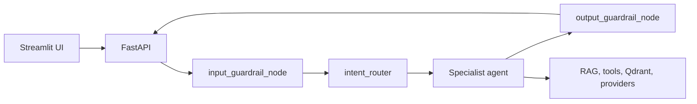

# FinPilot AI

FinPilot is an educational finance workspace that demonstrates a routed, multi-agent RAG system over finance and tax sources, market/news tools, portfolio calculations, and savings goals. It is an MVP with production-minded architecture and observability; it is not a production financial-advice or account-management system.

[](https://www.python.org/) [](https://fastapi.tiangolo.com/) [](https://langchain-ai.github.io/langgraph/) [](https://qdrant.tech/)

## What it demonstrates

- Intent routing to six specialist domains: Finance Q&A, Tax, Market, Portfolio, Goals, and News.
- Hybrid RAG with Qdrant, evidence assessment, citations, caching, and bounded tool execution.
- LangGraph input and output guardrail nodes around the specialist agent.
- LangSmith tracing, router A/B evaluation, prompt versioning, and request-level observability.
- A Streamlit workspace backed by a typed FastAPI API.

See the [architecture overview](docs/architecture.md) and [MVP scope](docs/mvp-scope.md).

## Architecture



Input guards redact PII and screen unsafe or blocked requests before model routing. Domain agents retain domain-specific evidence, citation, calculation, and fallback rules. The output node sanitizes and validates the user-visible response. See [guardrails](docs/guardrails.md).

## Specialist agents

| Agent | Purpose | Details |
| --- | --- | --- |
| Finance Q&A | Handbook-grounded investing education | [Finance Q&A](docs/agents/finance-qa.md) |
| Tax Education | US tax learning and deterministic calculations | [Tax](docs/agents/tax-education.md) |
| Market | Quotes, history, and instrument data | [Market](docs/agents/market-analysis.md) |
| Portfolio | Synthetic manager/customer portfolio analysis | [Portfolio](docs/agents/portfolio-analysis.md) |
| Goals | Savings and future-value projections | [Goals](docs/agents/goals.md) |
| News | Retrieved, cited financial-news synthesis | [News](docs/agents/news.md) |

## Quick start

Requirements: Python 3.12, an OpenAI API key, and provider keys for the market/news features.

```bash
git clone https://github.com/vinodkandibilla/ai-finance-assistant.git
cd ai-finance-assistant
python3.12 -m venv .venv
source .venv/bin/activate
python -m pip install -e '.[dev]'
cp .env.example .env
```

Set at least `OPENAI_API_KEY` in `.env`. For local Qdrant and the complete provider setup, see [configuration and operations](docs/api.md).

Run the backend and UI in separate terminals:

```bash
.venv/bin/python -m uvicorn finassist.main:app --reload
.venv/bin/python -m streamlit run src/finassist/web_app/app.py
```

Open [FinPilot](http://127.0.0.1:8501), [Swagger UI](http://127.0.0.1:8000/docs), or [health](http://127.0.0.1:8000/health).

## Evaluation and observability

Router cases, baseline/candidate prompts, local evaluators, and LangSmith publishing are documented in [evaluation](docs/evaluation.md). LangSmith captures the LangGraph run tree, model/tool spans, latency, tokens, and cost when provider usage metadata is available. See [observability](docs/observability.md).

## Cost baseline

The MVP uses `gpt-4o-mini` for most reasoning, answer caching for repeated Finance/Tax questions, bounded retrieval, limited expansion, and bounded retries. Establish measured token, latency, and cost ranges from LangSmith before changing these controls; see [cost optimization](docs/cost-optimization.md).

## API and development

The primary endpoints are `POST /query`, `POST /query/resume`, `GET /health`, and `GET /portfolio/managers`. The versioned contract is [docs/api/finassist-openapi.json](docs/api/finassist-openapi.json). Run focused tests with:

```bash
.venv/bin/ruff check src tests
.venv/bin/pytest -q
```

## Design considerations and scope

FinPilot intentionally separates domain correctness from shared safety: agents own evidence and calculation rules; graph guardrail nodes own cross-cutting input/output checks. Synthetic portfolio data and simulated context are clearly labeled. No real authentication, durable chat history, or personalized financial advice is provided.

Current limitations, deferred production work, and stretch goals are listed in [MVP scope](docs/mvp-scope.md). The previous detailed README is retained as a [reference archive](docs/reference/README-detailed.md) while the focused documentation evolves.
