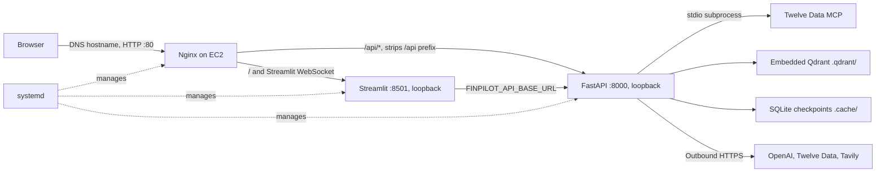

# Deploy FinPilot to EC2 without Docker

This guide installs the FastAPI backend, Streamlit UI and Twelve Data MCP server on one Ubuntu EC2 instance. Run the first-time steps once, then use the update steps whenever you change the application.

The commands assume **Ubuntu 24.04, Python 3.12**, login user `ubuntu`, and application directory `/home/ubuntu/finpilot`. The supplied systemd service files use these exact paths and user. If you choose a different user or application directory, edit both service files before installing them. Replace the sample EC2 IP, SSH key path, and hostname below with the values for the instance being deployed.

## Deployment architecture

This is a single-instance deployment without Docker. DNS maps the application hostname to EC2; Nginx is the public HTTP entry point and forwards requests to the two local application services.



| Component | Runtime address / role | Exposure and lifecycle |
| --- | --- | --- |
| Nginx | Public TCP 80; virtual host selected by `server_name` | Allow inbound TCP 80 in the EC2 security group. Proxies `/` to Streamlit and `/api/` to FastAPI. The supplied config is HTTP-only. |
| Streamlit UI | `127.0.0.1:8501` | Managed by `finpilot-ui.service`; calls FastAPI at `127.0.0.1:8000`. Not directly internet-accessible. |
| FastAPI | `127.0.0.1:8000`, one worker | Managed by `finpilot-api.service`; keep one worker with embedded Qdrant. Not directly internet-accessible. |
| Twelve Data MCP | Child process using stdio, separate virtual environment under `.cache/twelvedata-mcp/` | Started by the application when needed; no public port or separate systemd service. |
| Local state | Qdrant under `.qdrant/`; SQLite checkpoints under `.cache/` | Keep on the instance across application updates. Do not run duplicate API workers against local Qdrant. |
| External providers | Outbound HTTPS | EC2 needs outbound internet access for dependency/model downloads and configured provider calls. |

Inbound SSH TCP 22 should be limited to administrator IPs. Ports 8000 and 8501 should remain closed to public inbound traffic. This MVP deployment uses simulated-user mode and is not an authenticated public service; restrict access appropriately before exposing it broadly. See [application request flow and boundaries](architecture.md) for the internal agent architecture.

## 1. Prepare and connect — local Mac

In the EC2 security group, allow SSH (TCP 22) from your own public IP and HTTP (TCP 80) from the intended client IPs. The API and UI listen on localhost behind Nginx; ports 8000 and 8501 do not need public inbound rules. The steps below configure HTTP only; HTTPS is not enabled by the supplied Nginx config or installer.

```bash
EC2_IP=203.0.113.10
SSH_KEY="$HOME/.ssh/finpilot.pem"
chmod 400 "$SSH_KEY"
ssh -i "$SSH_KEY" "ubuntu@$EC2_IP"
```

Replace `203.0.113.10` with the instance's public IPv4 address and set `SSH_KEY` to the downloaded key file. The example IP is reserved for documentation and will not connect.

## 2. Prepare the instance — EC2

```bash
sudo apt update
sudo apt install -y python3.12 python3.12-venv git rsync curl nano
mkdir -p /home/ubuntu/finpilot
```

The instance needs outbound internet access to install dependencies, download local models and call providers. `python3.12-venv` supplies pip inside the virtual environment, so system-wide `python3-pip` is unnecessary. Install `build-essential` only if a dependency installation reports that it needs compilation tools.

## 3. Upload application files — local Mac

Run from your local repository root, in a separate terminal:

```bash
EC2_IP=203.0.113.10
SSH_KEY="$HOME/.ssh/finpilot.pem"
rsync -avz \
  -e "ssh -i '$SSH_KEY'" \
  --exclude='__pycache__/' \
  src scripts .streamlit pyproject.toml README.md .env.example \
  "ubuntu@$EC2_IP:/home/ubuntu/finpilot/"
```

Use the same `EC2_IP` and `SSH_KEY` values as in step 1. Run this from the repository root on your Mac. If you open a new terminal, set the two values again.

These are the deployment folders and files:

| Item | Why it is needed |
| --- | --- |
| `src/` | Application, prompts, bundled corpora and synthetic portfolio data |
| `scripts/` | MCP setup script and the two systemd service files |
| `.streamlit/` | UI configuration and theme |
| `pyproject.toml` | Package and dependency configuration |
| `README.md` | Referenced by package metadata during installation |
| `.env.example` | Template for server configuration |

You do not need to upload `docs/`, `tests/`, `evals/`, `resources/`, `.git/`, or your local virtual environment. Create `.env` on EC2. The rsync command deliberately omits `--delete`, preserving server configuration and runtime data.

The `-e` argument must contain **`ssh -i` followed by the key path**, not just the key path.

## 4. Install Python dependencies — EC2

```bash
cd /home/ubuntu/finpilot
python3.12 -m venv .venv
.venv/bin/python -m pip install --upgrade pip
.venv/bin/python -m pip install -e .
.venv/bin/python -m pip check
.venv/bin/python -c "import numpy, pyarrow, scipy, spacy; print('Native imports OK')"
```

Use the server's own virtual environment; do not copy one from macOS. Development/test dependencies are not required to run the application.

The package pins NumPy 1.26.4, PyArrow 17.0.0 and SciPy 1.13.1 for the existing spaCy 3.7 stack.
After uploading an updated `pyproject.toml`, rerun `pip install -e .` to apply
these versions. The import check above also catches native-library incompatibilities
that `pip check` alone may miss.

## 5. Configure the application — EC2

```bash
cd /home/ubuntu/finpilot
cp -n .env.example .env
chmod 600 .env
nano .env
```

Set these values in `.env`:

| Setting | Value or purpose |
| --- | --- |
| `OPENAI_API_KEY` | Required for model calls and embeddings |
| `TWELVE_DATA_API_KEY` | Required for Market provider tools |
| `TAVILY_API_KEY` | Required for News search |
| `QDRANT_MODE` | `local` for this single-instance deployment |
| `TWELVE_DATA_MCP_COMMAND` | `.cache/twelvedata-mcp/.venv/bin/python` |
| `TWELVE_DATA_MCP_ARGS` | `[".cache/twelvedata-mcp/src/server.py"]` |
| LangSmith settings | Optional tracing; use the names in `.env.example` |

Keep `APP_ENV=local` for the existing MVP's simulated-user experience. This is a demo configuration, not an authenticated public deployment. Remove any obsolete `INTENT_ROUTER_SYSTEM_PROMPT` override to use the prompt supplied with the code.

The backend reads `.env` from its working directory. Do not overwrite an existing server `.env` during subsequent uploads.

## 6. Install the Twelve Data MCP server — EC2

```bash
cd /home/ubuntu/finpilot
.venv/bin/python scripts/setup_twelve_data_mcp.py
```

The setup script downloads the pinned official server into `.cache/twelvedata-mcp/` and installs its dependencies in a separate virtual environment. The application starts it as a subprocess when needed; **no third systemd service or public MCP port is required**. News uses Tavily HTTPS directly.

## 7. Install and start both services — EC2

The repository already contains:

- [finpilot-api.service](../scripts/finpilot-api.service): FastAPI on `127.0.0.1:8000`, one worker.
- [finpilot-ui.service](../scripts/finpilot-ui.service): Streamlit on `127.0.0.1:8501`, calling the local backend.

Install the files into systemd:

```bash
cd /home/ubuntu/finpilot
sudo cp scripts/finpilot-api.service scripts/finpilot-ui.service /etc/systemd/system/
sudo systemctl daemon-reload
sudo systemctl enable --now finpilot-api finpilot-ui
sudo systemctl status finpilot-api finpilot-ui --no-pager
curl --fail http://127.0.0.1:8000/health
```

If the health check runs before startup completes, wait a few seconds and repeat it.

`daemon-reload` reloads service definitions. `enable --now` starts the services immediately and enables startup after a reboot. `--no-pager` prints status directly; it is optional.

Keep one backend worker while using embedded Qdrant. Do not add `--reload` to the backend service. If you change the installation directory or Linux user, update both service files before installing them.

## 8. Configure Nginx — EC2

Choose the hostname for this deployment, for example `finpilot.example.com`, and create a DNS A record pointing it to this EC2 instance's public IP. For a second instance running beside an existing deployment, use a separate hostname for testing; to move the existing hostname, change its DNS record only after the new instance passes the checks below. Allocate an Elastic IP if the address must remain stable.

Before uploading or installing Nginx, edit `scripts/finpilot.nginx.conf` in the local repository and set `server_name` to the chosen hostname. Upload `scripts/` again after changing it. Allow inbound HTTP (TCP 80) from the intended client IPs in the EC2 security group. Then run the installer on EC2. It installs Nginx, enables the site, validates the configuration and reloads the service. Ubuntu's default site remains enabled for requests that do not use the FinPilot hostname.

```bash
cd /home/ubuntu/finpilot
bash scripts/install-ngnix.sh
sudo systemctl restart finpilot-ui
```

The Nginx site sends requests for the configured hostname and Streamlit WebSocket traffic to port 8501. Requests under `/api/` go to FastAPI on port 8000 with the `/api` prefix removed, so `/api/health` reaches the backend's `/health` endpoint. The app and API are available over HTTP at the chosen hostname. To add HTTPS, allow inbound TCP 443 and configure a TLS certificate and Nginx HTTPS server block; those steps are not performed by this installer.

## 9. Open the application — local Mac

Visit `http://<your-hostname>` and check `http://<your-hostname>/api/health` (replace `<your-hostname>` with the hostname configured in DNS and Nginx).

Check a Finance question, a Market quote, a News search and a Goals calculation. Initial RAG use may take longer while indexes and local models initialize. `/health` confirms process health; it does not verify provider credentials, quotas or complete RAG readiness.

## 10. Deploy later changes

For a consistent update, briefly stop both services on **EC2**:

```bash
sudo systemctl stop finpilot-ui finpilot-api
```

On your **local Mac**, run the same rsync command from step 3. Then return to **EC2**:

```bash
cd /home/ubuntu/finpilot
```

Apply only the additional steps appropriate to the change, before starting the services:

| What changed | Additional action on EC2 |
| --- | --- |
| Python code or prompts only | No installation step; starting the stopped services loads the uploaded code |
| Dependencies or package configuration | Run `.venv/bin/python -m pip install -e .` and `.venv/bin/python -m pip check` |
| Server settings or keys | Edit the existing `.env` |
| Either `.service` file | Copy both service files again, then run `sudo systemctl daemon-reload` |
| Nginx config or installer | Upload `scripts/`, then rerun `bash scripts/install-ngnix.sh` |
| MCP setup or pinned server version | Rerun `.venv/bin/python scripts/setup_twelve_data_mcp.py` |
| Finance/Tax source corpus | Plan an index refresh; uploading a changed corpus does not automatically rebuild populated collections |

After applying the relevant changes, start and check both services:

```bash
sudo systemctl start finpilot-api finpilot-ui
sudo systemctl status finpilot-api finpilot-ui --no-pager
curl --fail http://127.0.0.1:8000/health
```

If the health check runs before startup completes, wait a few seconds and repeat it.

For a settings-only change while the services are running, use `sudo systemctl restart finpilot-api finpilot-ui`. You do not need to repeat `enable` on every update.

Preserve the server's `.env`, `.venv/`, `.cache/` and `.qdrant/`. Checkpoint files and the MCP installation live under `.cache/`; local retrieval indexes live under `.qdrant/`. Process-memory caches are cleared on restart, and the synthetic portfolio database is recreated. See [storage details](api.md#storage-and-index-lifecycle).

## 11. Optional troubleshooting — EC2

Use these commands when diagnosing a problem; they are not required for every deployment.

Follow both services' console logs:

```bash
sudo journalctl -u finpilot-api -u finpilot-ui -f
```

Read the last 100 backend log lines:

```bash
sudo journalctl -u finpilot-api -n 100 --no-pager
```

Press `Ctrl+C` to stop following logs; the services continue running.

| Symptom | Check |
| --- | --- |
| SSH/rsync permission denied | Correct key, `ubuntu` user, key permissions and security-group SSH source |
| Service fails immediately | `journalctl`, working directory, virtual environment and package installation |
| Market tools fail | Twelve Data key, MCP setup files and outbound connectivity |
| UI cannot reach backend | API service status and `/health`; UI service sets `FINPILOT_API_BASE_URL` |
| Browser cannot open UI | Check Nginx status/logs, inbound TCP 80, and both app services |
| Qdrant reports a storage lock | Stop duplicate manual backend processes; use one service worker |

These commands and paths are checked against the repository configuration. Deployment and provider smoke checks must be run on the EC2 instance after installation. For a new instance, verify that DNS resolves to that instance, `sudo nginx -t` succeeds, both systemd services are active, and the domain's `/api/health` endpoint responds before moving production DNS to it.
