# FinPilot MVP Overview

## The problem we set out to solve

Imagine a user learning what an ETF is, then asking how a stock sale is reported for tax purposes, and finally exploring a savings goal. Each question belongs to finance, but each needs different evidence and calculations. A portfolio manager adds another requirement: access must stay within the customers assigned to that manager.

FinPilot brings these tasks into one educational workspace. The design starts by identifying the kind of help requested, then delegates to a specialist with the appropriate context and tools. It supports financial understanding and hypothetical analysis; it does not execute investments or prepare complete tax returns.

## Choosing an achievable MVP

We scoped the capstone around six concrete capabilities. Broader requirements become future milestones rather than implied features. The MVP uses synthetic portfolio identities and records, curated educational evidence, external market/news providers, and deterministic calculators. Local execution is the current demonstration baseline; AWS deployment work is paused.

## Six specialists with clear responsibilities

**Finance Education** Explains fundamentals from a cited handbook and supports simple and compound interest calculations.

**Tax Education** Explains supported US federal tax topics and provides a limited 2026 ordinary income tax calculator.

**Portfolio Analysis** Retrieves and compares authorized synthetic portfolios and discusses alignment with stored profiles.

**Market Intelligence** Retrieves quotes and historical observations, then calculates supported growth or extrema.

**Goal Planning** Projects savings, contributions, timelines, and deadline feasibility from stated assumptions.

**News Synthesis** Finds financial articles and turns retrieved evidence into supported summaries and source links.

## What is deferred

Real authentication, brokerage integration, order execution, distributed scaling, shared distributed caches, broader tax coverage, and explicit per-MCP-attempt timeouts are outside this MVP. Existing budgets, caching, and early stopping provide cost controls; comprehensive cost optimization and tuning remain future work.

---

## One workspace with specialized execution

A user begins in Streamlit, using a page workflow or the shared chat. FastAPI validates the request, shared guardrails examine it, and LangGraph coordinates a specialist. The specialist can retrieve evidence, call a provider, or run Python calculations. The response returns through output checks and API validation before the UI displays it.

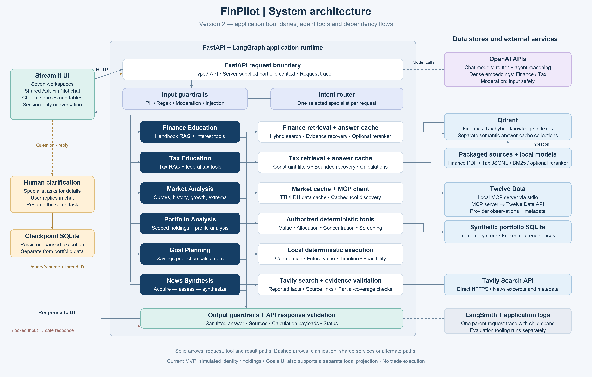

[Editable SVG](architecture/assets/finpilot-architecture-v2.svg)

The boundaries explain the design: Finance and Tax use Qdrant; Portfolio uses seeded relational SQLite data; Market reaches Twelve Data through MCP; News calls Tavily directly; Goals uses local calculators. Shared checkpoint storage is separate from every domain data source. LangSmith traces connect request handling, model calls, and tool activity.

### MVP capabilities

The workspace supports cited educational answers, portfolio dashboards, market charts and two-stock comparisons, savings projections, news cards, and clarification. Source availability and provider coverage determine what the application can support; an answer may explicitly report insufficient evidence.

---

## Routing the request and keeping the user involved

Consider “Show Emma’s portfolio.” The router selects portfolio, and that specialist resolves Emma within the current user’s authorized scope. If essential details are ambiguous, the specialist asks a question instead of guessing. The user supplies the missing detail and execution continues.

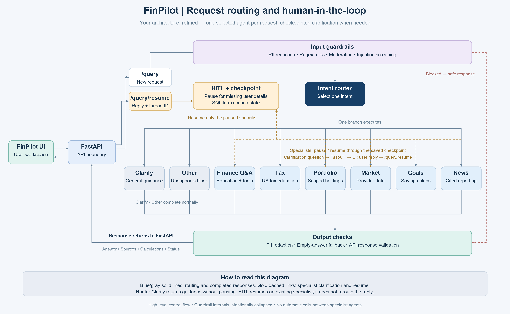

[Editable SVG](architecture/assets/finpilot-request-routing-and-hitl.svg)

The router recognizes finance_qa, tax, portfolio, market, goals, news, clarify, and other. It selects one specialist per request. The other intent handles unsupported questions. Router-level clarify returns a question normally; specialist clarification can interrupt execution and save a checkpoint. /query/resume continues that paused workflow.

Input processing includes PII redaction, regex checks, and configured moderation and injection checks. Output processing applies PII protection and response-contract validation. Application identity is supplied by the application rather than trusted from a user prompt or a model-generated tool argument.

---

## Graph state and memory

Suppose a user asks how much to save monthly for USD 20000 but gives no deadline. The Goals agent has part of the task already. It can save its progress, ask for the missing horizon, and continue with that same target when the user replies “5 years.” This is checkpointed execution, not a new question sent through the router.

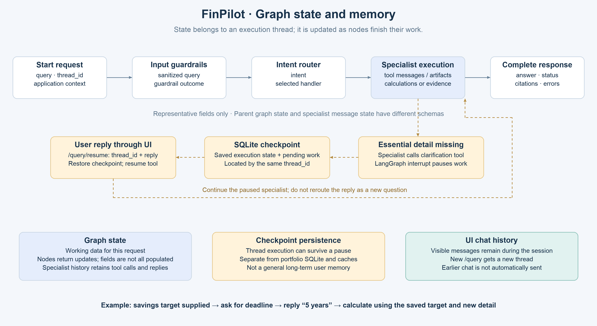

[Editable SVG](architecture/assets/finpilot-graph-state-memory.svg)

### What the graph carries

The parent graph carries the effective query, thread_id, intent, application context, guardrail outcome, and final response fields. Depending on the specialist, results include calculations, citations, errors, and status. Specialist tool loops separately retain model messages, tool calls, tool results, and clarification replies. The diagram groups representative data; it does not imply every field is populated or every tool artifact is copied into the parent state.

### How updates and checkpoints work

Each node reads the state it needs and returns updates. New /query requests receive a new thread ID. The shared AsyncSqliteSaver persists workflow checkpoints in .cache/finance_agent_checkpoints.sqlite. On an interrupt, the UI receives the clarification and thread ID. /query/resume supplies that ID and a redacted reply through Command(resume=...), continuing the paused specialist with its saved history. A clarification reply need not overwrite the original query.

### The memory boundary

UI chat history keeps messages visible during the session, but previous messages are not automatically sent with a new question. Checkpoints support continuation of the same interrupted task; long-term conversational memory and cross-request user fact recall are not implemented. Checkpoint SQLite is separate from the synthetic portfolio database, semantic answer caches, and Market response cache.

For review, LangSmith exposes state transitions and tool steps; tests and evaluations check selected contracts, access boundaries, calculators, recovery, and caching. Representative examples and traces support assessment, but do not establish that every answer is correct. Current defaults should be tuned using measured coverage, latency, and cost.

---

## Finance Education starts with a traceable corpus

Before answering “What is an ETF?”, FinPilot needs searchable evidence. The handbook PDF is read into LangChain Documents containing page text and citation metadata. Recursive splitting produces smaller passages while preserving links back to the source.

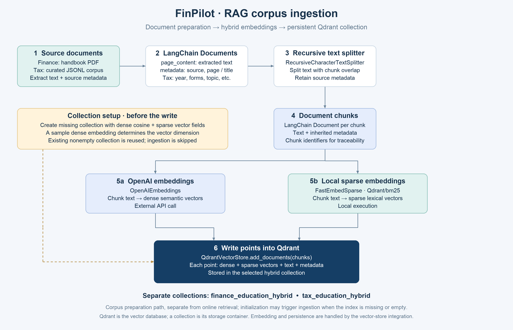

[Editable SVG](architecture/assets/finpilot-rag-ingestion.svg)

Finance uses 800-character chunks with 120-character overlap. OpenAI produces dense embeddings; local FastEmbed Qdrant/bm25 produces sparse vectors. Qdrant stores both vectors alongside text and metadata in finance_education_hybrid. A collection is the database container, so adding points to it is the persistence step.

This preparation is separate from online retrieval, although initialization can trigger it when the collection is missing or empty. Existing populated collections are reused. Source/page metadata and chunk identifiers allow retrieved evidence to remain traceable. Tax follows the same preparation pattern from JSONL records rather than PDF pages.

---

## Finance Education follows evidence before answering

For a definition, an eligible semantic answer-cache hit can avoid retrieval. On a miss, the agent searches by meaning and lexical terms, then checks whether the passages support the requested explanation. Missing facts can trigger Evidence Expansion or a Targeted Query Rewrite.

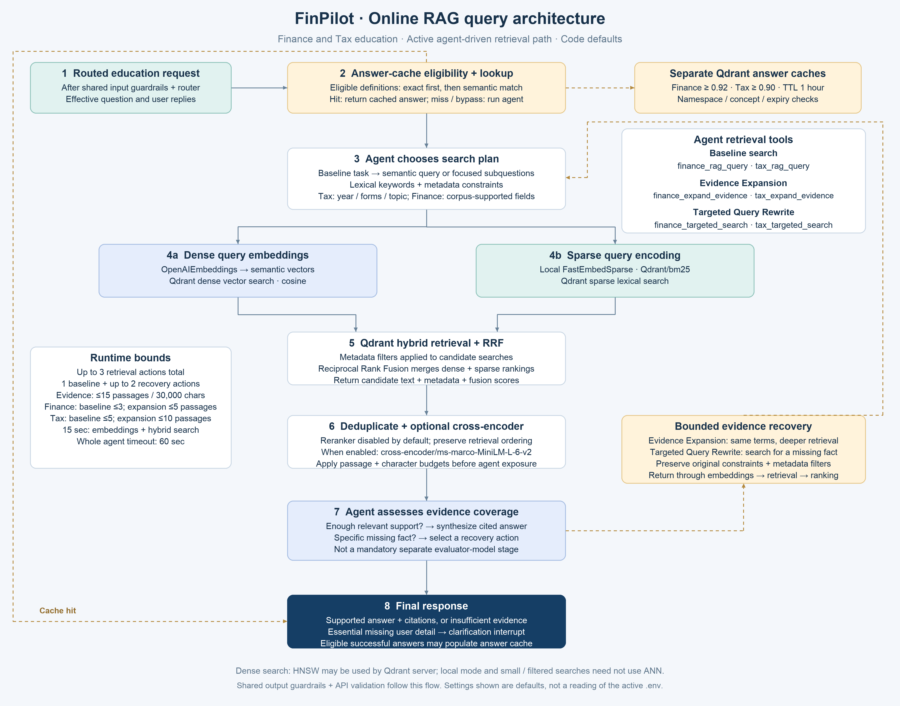

[Editable SVG](architecture/assets/finpilot-rag-query.svg)

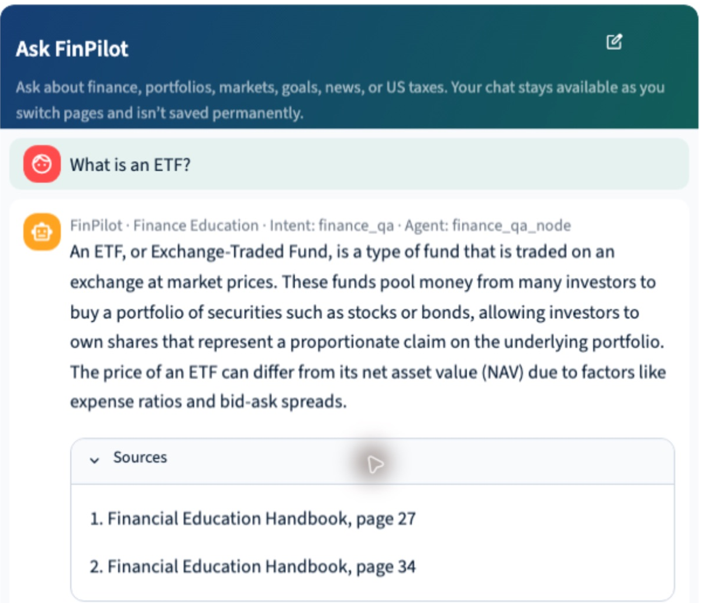

Qdrant combines dense cosine and sparse BM25 rankings through Reciprocal Rank Fusion. Explicit corpus-supported metadata can constrain searches. The optional cross-encoder reranker is disabled by default. HNSW may be used by Qdrant server; local search does not guarantee ANN execution.

Defaults allow three retrieval actions total. Baseline exposes up to three passages; expansion up to five. The shared evidence cap is 15 unique passages and 30,000 characters. Embeddings plus hybrid retrieval have a 15-second timeout; the agent has a separate 60-second timeout.

**Tools** finance_rag_query, finance_expand_evidence, finance_targeted_search, calculate_simple_interest, calculate_compound_interest, clarification tools, submit_finance_answer.

### Example queries

- What is an ETF, and how does it differ from a mutual fund?

- Explain diversification and why holding count alone can be misleading.

- Calculate compound interest on USD 1,000 at 5% annually for three years.

---

## Tax Education preserves the year and the evidence

A tax explanation can look familiar while depending on a different year, form, or filing context. FinPilot therefore keeps explicit tax constraints attached to the search and recovery steps. When the available corpus cannot support the requested facts, it reports the gap.

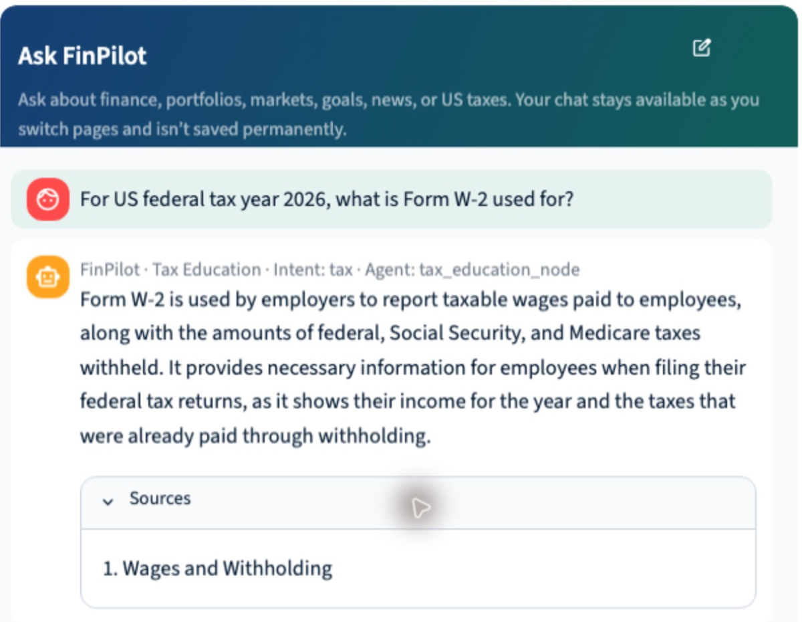

Tax uses the shared ingestion architecture shown on page 5 and retrieval architecture on page 6.

Curated JSONL records become LangChain Documents and are split into 800-character chunks with 120-character overlap. Dense and sparse vectors populate tax_education_hybrid. Metadata includes tax year, filing year, forms, and topic when supplied. Explicit year constraints are preserved during retrieval.

Online search uses the Finance hybrid retrieval and recovery pattern. Tax selects up to five baseline/targeted passages or ten expanded passages within the three-action total and shared evidence caps. Its definition cache is separate. The limited calculator covers 2026 federal ordinary income tax before credits and payments, not a full return or refund calculation.

**Tools** tax_rag_query, tax_expand_evidence, tax_targeted_search, calculate_federal_ordinary_income_tax, ask_tax_clarification, submit_tax_answer.

### Example queries

- For US federal tax year 2026, explain standard versus itemized deductions.

- For tax year 2026, explain how wages, bank interest, and an 18-month stock sale are generally reported; do not calculate tax owed.

- For tax year 2026, what does Form W-2 report, and how does withholding differ from final tax liability?

---

## Portfolio Analysis respects who is asking

A manager selecting PM001 should see assigned customers, while an individual customer should see their own portfolio. This scope follows application identity into the tools. The LLM chooses the operation; Python enforces access and calculates the metrics.

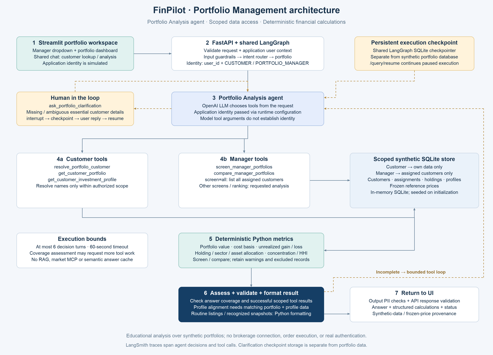

[Editable SVG](architecture/assets/finpilot-portfolio-management.svg)

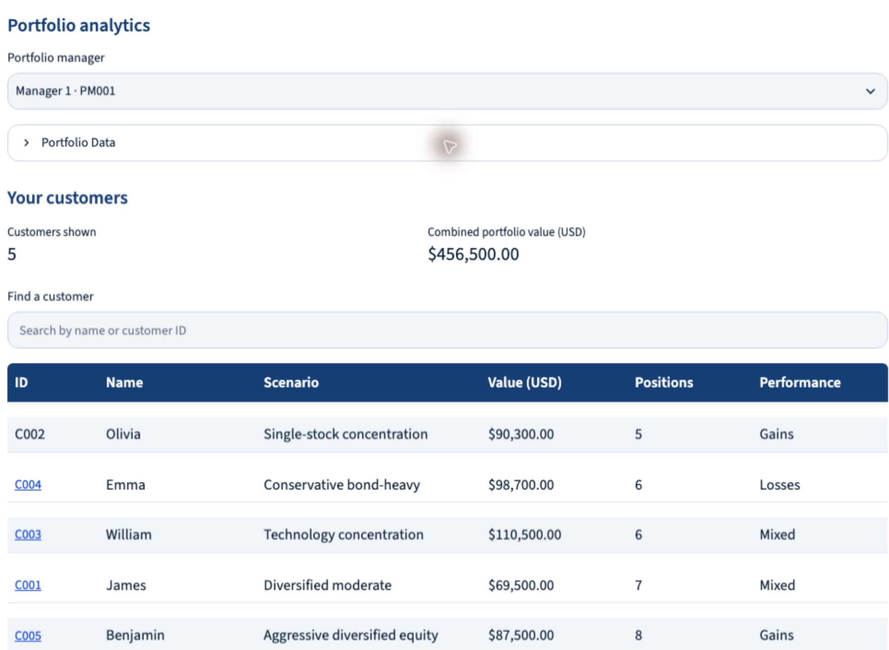

In-memory SQLite holds seeded managers, assignments, holdings, stored profiles, and frozen prices. Goals, risk tolerance, horizon, and liquidity needs are predefined synthetic onboarding outcomes. They are not inferred from holdings. Metrics cover value, cost basis, unrealized gains/losses, allocation, and concentration.

**Tools** resolve_portfolio_customer, get_customer_portfolio, get_customer_investment_profile; screen_manager_portfolios and compare_manager_portfolios; ask_portfolio_clarification.

Routine listings and recognized snapshots use Python formatting. Six main-agent LLM responses are allowed per request, retained across clarification; tool results and separate assessments are excluded. The active timeout is 60 seconds. There is no brokerage connection or portfolio RAG.

### Example queries

- List all portfolio customers assigned to me.

- Show the portfolio of Emma.

- Compare Emma and William by allocation and concentration.

---

## Market Intelligence turns provider observations into results

“What was NVDA’s lowest price in the last three months?” requires observations rather than model memory. The agent resolves the symbol and timeframe, retrieves history through Twelve Data MCP, and uses deterministic calculations to identify the observed minimum.

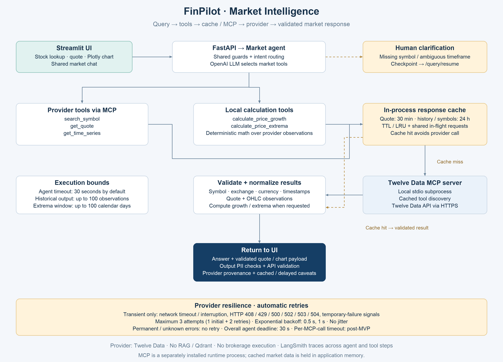

[Editable SVG](architecture/assets/finpilot-market-intelligence.svg)

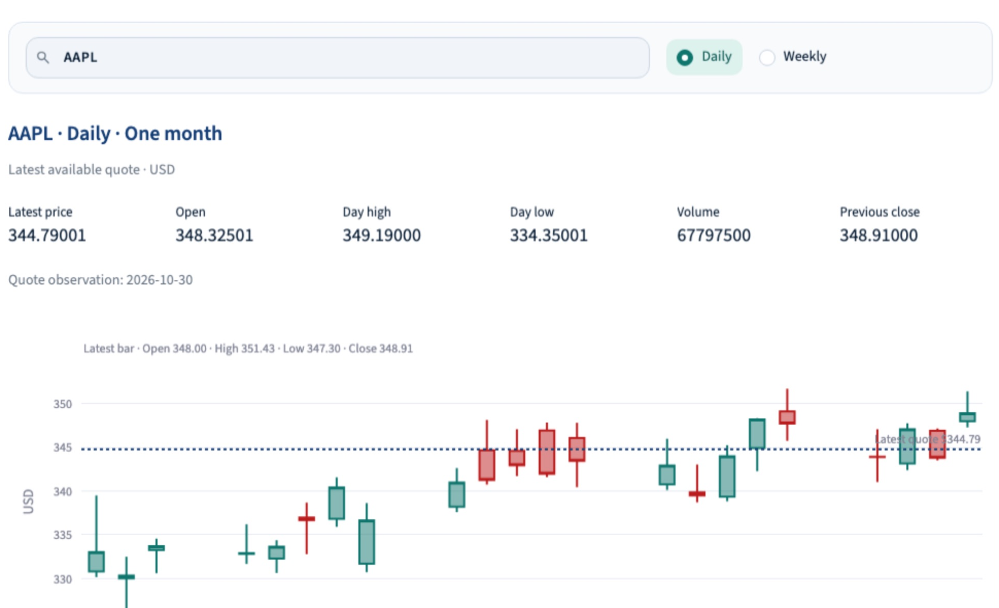

**Tools** search_symbol, get_quote, get_time_series via MCP; calculate_price_growth and calculate_price_extrema locally. Timeframe parsing is an internal helper.

The UI offers quote and OHLC charts, daily/weekly views, and two-stock comparisons. Daily charts request one month; weekly charts request three months. Historical output is capped at 100 observations; extrema windows at 100 calendar days. Responses disclose provider timestamps, currencies, and coverage limitations when available.

The in-process TTL/LRU cache stores quotes for 30 minutes and symbol/history data for 24 hours, sharing matching in-flight fetches. Transient-only retries allow three attempts total with exponential backoff. The overall timeout is 30 seconds; per-call timeout remains deferred. MCP is a separately installed subprocess.

### Example queries

- Show the latest available quote and daily chart for AAPL for the last month.

- Compare AAPL and MSFT price performance over the last month.

- What was the lowest observed NVDA price in the last two months?

---

## Goal Planning makes assumptions visible

A user may know the target but not the required monthly savings. Another may know a monthly budget and want to estimate a timeline. The agent identifies which question is being asked, gathers the required inputs, and delegates arithmetic to Python.

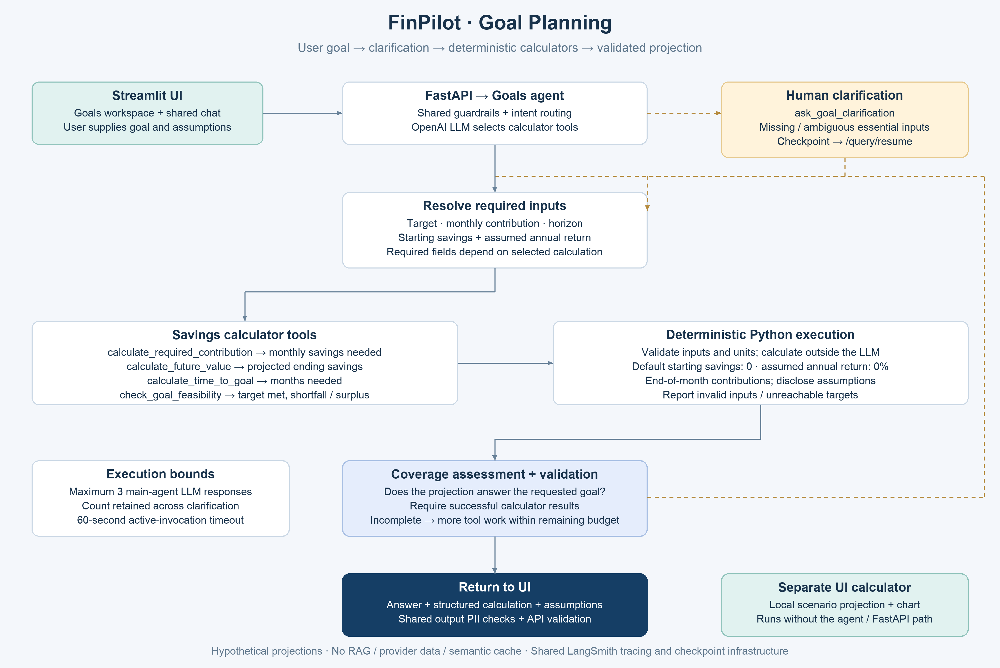

[Editable SVG](architecture/assets/finpilot-goal-planning.svg)

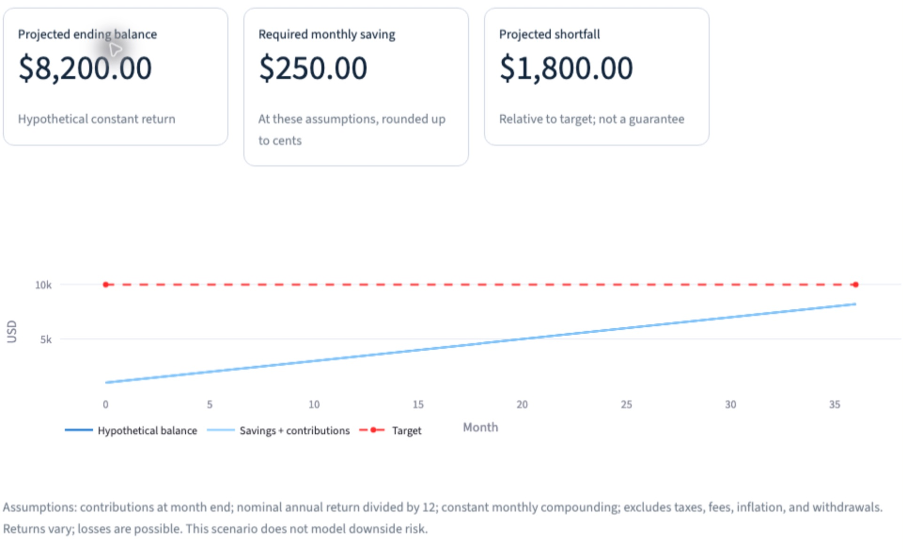

**Tools** calculate_required_contribution, calculate_future_value, calculate_time_to_goal, check_goal_feasibility, ask_goal_clarification.

Starting savings and assumed annual return default to zero when omitted. Contributions are modeled at month end. Results disclose assumptions, shortfalls, and unreachable targets. The model explains calculator outputs rather than supplying its own arithmetic. No external data provider or RAG is required.

The limit is three main-agent LLM responses retained across clarification, with a 60-second active timeout. A separate local UI scenario calculator produces projections and charts without the agent path.

### Example queries

- How much should I save monthly to reach USD 20,000 in five years, starting from zero at 0% return?

- What could USD 300 monthly grow to in ten years with a hypothetical 4% annual return?

- Can USD 200 monthly reach USD 15,000 in five years, starting with USD 2,000 at 0% return?

---

## News Synthesis searches first and summarizes second

For “Summarize this week’s technology earnings news,” the category and publication window establish the search scope. Tavily supplies article evidence. FinPilot assesses coverage, optionally searches for a missing aspect, and then writes a summary grounded in retrieved IDs.

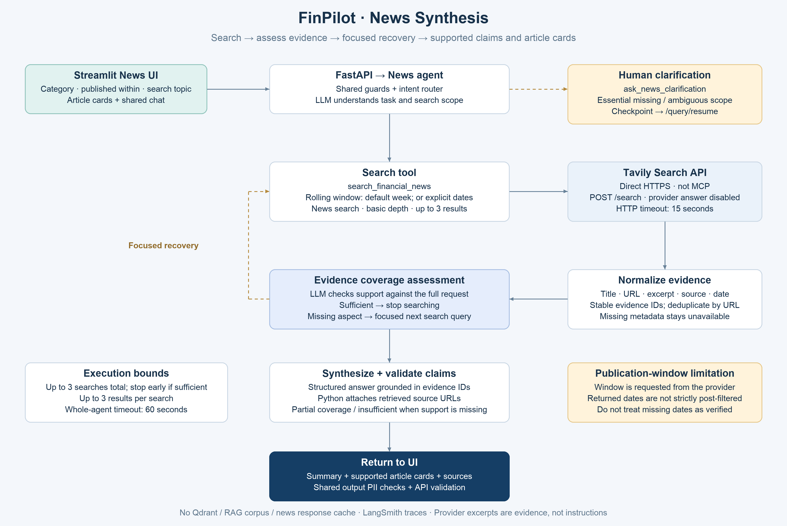

[Editable SVG](architecture/assets/finpilot-news-synthesis.svg)

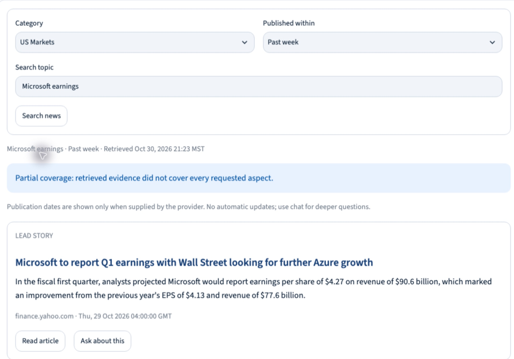

**Tools** search_financial_news and ask_news_clarification. Tavily is called directly over HTTPS, not MCP.

include_answer=False disables Tavily’s generated answer. Up to three results are requested per search and three searches are allowed in total, stopping early when sufficient. HTTP timeout is 15 seconds; agent timeout is 60 seconds. Python attaches original URLs; missing metadata is not invented.

The tool defaults to a rolling week; explicit dates override that window. Returned dates are not strictly post-filtered, so older results may appear. A custom topic replaces the category search text. Out-of-domain questions return unsupported handling. No Qdrant news index or persistent news response cache is used.

### Example queries

- Summarize US financial-market news from the past week with sources.

- Give one supported sentence each on the latest earnings reports of Alphabet, Microsoft, Meta, and Amazon.

- What financial news about semiconductor companies was reported in the past month?

---

## Observing a request in LangSmith

The ETF answer shown in the Finance walkthrough can be followed inside a single request trace. The overview connects input guardrails, routing, the Finance specialist, cache activity, and output checks. The detail view explains what happened inside the retrieval tool rather than treating RAG as one opaque operation.

Left: the request execution tree. Right: baseline hybrid retrieval inside finance_rag_query.

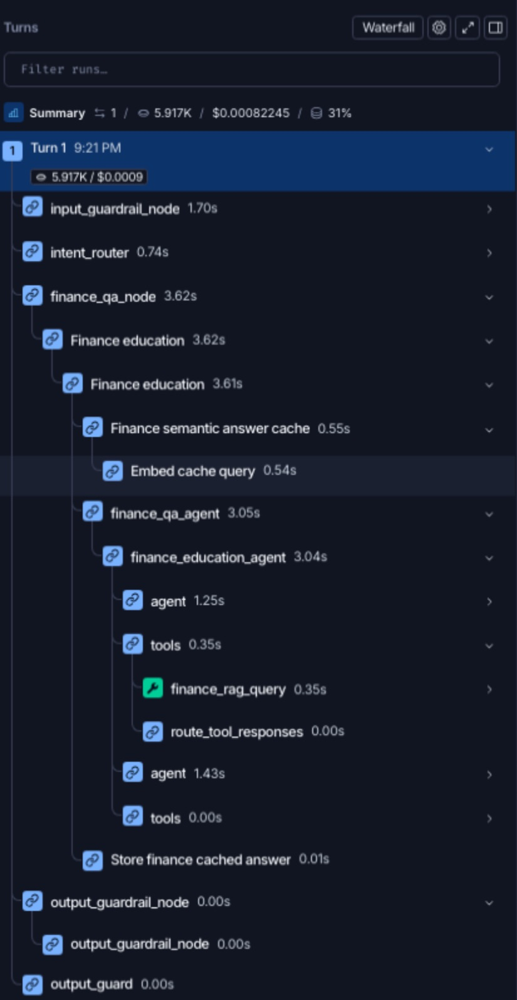

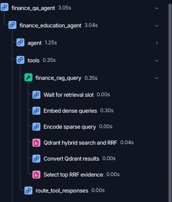

### What this execution shows

The semantic answer-cache lookup is followed by finance_rag_query, then a cached-answer storage step. Within retrieval, spans show waiting for a retrieval slot, dense query embeddings, local sparse query encoding, Qdrant hybrid search and RRF, conversion of results, and selection of top RRF evidence. This capture shows baseline acquisition; it does not demonstrate Evidence Expansion, Targeted Query Rewrite, or an enabled cross-encoder reranker.

Durations identify where this request spent time. Token and cost figures describe this captured run, not expected production averages. Rounded 0.00-second spans are short operations, not proof of zero work. A displayed aggregate cache percentage is not proof that the semantic answer cache served this request.

The supplied parent output shows status null. The trace is used here to demonstrate execution visibility, not to certify a successful response-status contract. UI captures illustrate actual local application behavior at capture time, not independently verified financial facts; Goals shows the separate local calculator and News reports partial coverage.
